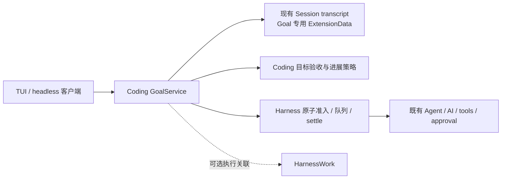

# Loushang `/goal` 命令设计与实施方案

## 状态与交付边界

- Authority: proposed — implementation proposal, non-normative
- Design status: proposed
- Implementation status: not-implemented
- Owner: Coding；跨界合同由 Loushang architecture 协调
- 日期：2026-10-15；方案版本：R3（R2 复核后限定导航语义，复核输入）
- Current 基线：本地 `main` `f2797520f3c6596aef58936ddb1a4400f546172c`；未声明与远端同步。
- 方法咨询版本：本地 archmethod `master` `0f9bd3ff51afabeaaf76cc38dff1ceb279b7d37e`，咨询时干净；不变更项目已采用的方法版本。

本次交付为调研结论、可实施方案和三视角独立评审，不包含命令实现或发布。下文所有新增类型、路径、事件、测试均为拟议。评审通过表示方案可供实施，不表示功能已存在，也不自动接受为 Target。

## 1. 要解决的问题与学习结论

普通 prompt 的结束点是当前回合；Goal 的结束条件是用户指定的结果已经得到验证。它允许路径随证据变化，同时保留原目标、约束和验收要求。适用于故障排查、迁移、性能改进、持续研究等需要多回合的工作。

Codex 的公开材料将 Goal 定义为会话内的持久目标，结合生命周期控制、回合间续跑、预算和证据检查。[官方使用说明](https://developers.openai.com/cookbook/examples/codex/using_goals_in_codex)

对实现的本地核对得到五项可借鉴机制：持久状态独立于上下文摘要；续跑经过宿主空闲准入；用户控制优先；用量归属到目标与实际执行；完成前核对证据。当前参考实现已经通过可选扩展接入生命周期、工具和用量。另需明确两类保证：代码可以限制状态迁移和启动条件；“证据足够”“同一语义阻塞持续存在”等判断仍包含模型判断。公开说明对“无工具就停止续跑”的概括与本地源码的具体反空转条件存在差异，不能据此前者写死产品行为。本方案采用显式进展记录和运行时熔断，不把一次工具调用视为实际进展。

参考源码的详细路径、版本、分析和原始评审保留在产品仓库外的研究目录。本文件只保留独立表达的产品设计结论。

## 2. Current：已有能力与缺口

| 责任 | 当前证据 | 本方案复用 / 缺口 |
| --- | --- | --- |
| 命令与呈现 | [command_pack.py](../../../src/loushang/harness/session/command_pack.py)、[catalog.py](../../../src/loushang/harnesstui/commands/catalog.py) | 复用命令描述与 dispatch；缺 Goal 命令及状态投影 |
| 队列 | [queue_controller.py](../../../src/loushang/harness/session/queue_controller.py)、[turn.py](../../../src/loushang/harness/runtime/turn.py) | 复用 steering/follow-up/next-turn；缺覆盖宿主执行和全部队列的原子空闲准入 |
| 应用输入 | [application_input.py](../../../src/loushang/harness/session/application_input.py) | 复用应用消息；`trigger_turn` 本身不能证明空闲准入 |
| 事件 / 恢复 | [agent_event_router.py](../../../src/loushang/harness/session/agent_event_router.py)、[events.py](../../../src/loushang/harness/extensions/events.py) | agent_end 后仍有 retry/compaction；缺 settled 后的统一 idle 通知 |
| 持久化 | [session.py](../../../src/loushang/harness/transcript/session.py)、[unit_of_work.py](../../../src/loushang/harness/transcript/unit_of_work.py)、[writer_lease.py](../../../src/loushang/harness/transcript/writer_lease.py) | 复用 ExtensionData、提交和 writer lease；缺 Goal reducer/schema |
| 模型输入 / 用量 | [model_call.py](../../../src/loushang/harness/session/model_call.py)、[model_usage_types.py](../../../src/loushang/harness/transcript/model_usage_types.py) | 已有 committed Model Input 与 attempt usage；缺 goal_id 归属、预算和缺失用量策略 |
| 执行收尾 | [execution_guard.py](../../../src/loushang/appservice/execution_guard.py) | task 完成与 settle 分离；不可用 task.done 认定可续跑 |
| 持久 Work | [HarnessWork 架构](../architecture/harnesswork/README.md)、[session.py](../../../src/loushang/harnesswork/integrations/session.py) | Work 有独立终局；Goal 不能重定义 Work success |

源码和测试中尚未发现实现 `/goal`、`create_goal`、`get_goal`、`update_goal` 的产品入口。当前已有的 Codex goal 执行笔记不构成该功能。

## 3. 要求、范围与可观察结果

| ID | 要求 | 交付验收 |
| --- | --- | --- |
| G01 | 显式设置、查看、编辑、暂停、继续、清除；一个 Session 一个当前 Goal | TUI 与 headless 同一服务；非法输入不启动模型；未完成目标不能被模型覆盖 |
| G02 | 目标、状态、预算、进度跨压缩和进程重启保存 | replay 得到一致 snapshot；摘要不能改变 Goal |
| G03 | 回合 settled 后自动推进；用户输入和既有维护工作优先 | 并发测试只出现一个被准入 turn；忙时无循环重试 |
| G04 | 暂停、清除、Esc、切换、退出可阻止后续自动执行 | 返回后无新目标执行；已有副作用有明确收尾责任 |
| G05 | 保留原目标，完成有逐项证据；阻塞可说明与恢复 | 缺项拒绝 complete；完整审计可回查；阻塞恢复重置计数 |
| G06 | 可选 token 预算、明确计费范围、幂等记账 | 重复 usage 不重复收费；缺失可见；达到预算不发新请求 |
| G07 | 恢复不自动重复外部动作，旧工作区仍可使用 | 崩溃窗口逐一测试；无 Goal 的历史不迁移、不重置 |
| G08 | Goal 不授予新权限，不绕过工具 approval / sandbox | 原策略仍执行；提示注入不能改权限或其他 Session 状态 |
| G09 | 可诊断续跑 / 停止原因，UI 状态来自服务端事实 | 显示目标、状态、预算、最近进展、停因；断线重连收敛 |
| G10 | 与 Work/Method 边界一致，分阶段仍交付完整纵向链路 | 普通 Goal 无需 Method；Work 终态不直接当 Goal 终态 |

场景源为用户本次需求与现有运行时约束。长期无人值守、团队共享 Goal、定时唤醒、多目标并行、跨设备自动接管不在此命令首版范围；这些排除不减损会话中自动跨回合执行、持久化和可恢复能力。无预算表示用户未设 token 上限，仍受权限、停机和反空转约束。

## 4. 方案比较与职责

| 方案 | 收益 | 代价与结论 |
| --- | --- | --- |
| TUI 结束时再发一句继续 | 修改少 | headless 失效、无持久权威、绕开宿主竞争；不选 |
| 在 Agent loop 内增加 goal 循环 | 能直接续推理 | 将会话准入、预算、持久化和产品验收塞入底层；不选 |
| 每个 Goal 固定成为一个 WorkRun | 可借 Work journal | 当前 Work 终态不可逆，与长期 pause/resume/edit 不同；需改变 Work 协议才能适配，不作为前提 |
| Coding 可选 Goal 扩展 + Harness 窄执行合同 | 与现有产品责任一致，可渐进复用 | 需补齐 idle/准入合同和结构化目标记录；选择此方案 |



| Owner | 拥有 | 不拥有 |
| --- | --- | --- |
| Coding GoalService | 用户意图、Goal 生命周期/记录、预算归属、进展策略、完成审计、命令/工具 binding | 第二个 turn loop、工具权限、Work 终态 |
| Harness Session | 通用原子执行准入、输入优先、settle 通知、application input、Model Input / usage 原始事实 | GoalStatus、目标含义、目标审计 |
| HarnessWork | 已接受 Work 的 admission、run/step、唯一终态、事件与取消 | 会话 Goal 的继续/替换策略 |
| Method | 可选过程与验收契约定义 | Goal 调度与状态 |
| Harnesstui / Coding UI | 中立命令/状态呈现与 Coding 文案 | 自动续跑决定、状态写入权威 |
| AppService / AppHost | 现有授权、连接、执行宿主与资源收尾 | 另一套 Goal 聚合根或后台调度器 |

第一实现放在拟新增 `coding/goal/`，不创建泛化 `harness.goal` 包。只有第二个真实产品复用并证明相同中立契约后，再以单独边界决定提取。依赖保持 Product → Harness/HarnessWork；Harness 不 import Coding、HarnessWork、Method 或 UI。该选择遵守 [Harness owner map](../architecture/harness/current-owner-map.md) 和 [Method 自主性边界](../architecture/method/README.md)。

Goal 是会话级结果契约；WorkRun 是一次执行承诺，Turn 是一次模型交互。一个 Goal 可关联零到多个 WorkRun；每个关联 Work 独立结束。Work succeeded 只提供验收候选证据；Goal complete 只停止 Goal 续跑。暂停 Goal 不将所有历史 Work 改成 cancelled。持久化与 replay 复用 transcript，并未复制 Work scheduler/journal。

每个 live Session/generation 只由 Coding Product composition root 创建一个 GoalService，注入命令、工具、context 和 UI consumer。重连借用同一服务；refresh 不得重建第二套订阅。关闭时先 fence，等待既有 execution owner 收尾，再撤销订阅/registrations。GoalService 不保有 turn task 队列、工具执行器或独立取消栈。

用户实际选择并 enact Method 时，沿现有 Coding preparer/executor 生成冻结 Work contract，HarnessWork 拥有 run/step/deviation/terminal；Goal 只存 WorkRef 和 requirement→evidence 映射。pause/edit 只影响当前带 Goal attribution 的执行；历史 Work 终态不变。Method revision 变动通过原 Work binding 处理，不能在 Goal ExtensionData 中重建一份正式 plan。V11 必须覆盖 Method-backed Goal 的暂停、重验和历史终态。

## 5. 状态、权限和命令合同

拟议公开状态：`active / paused / blocked / usage_limited / budget_limited / complete`；没有 Goal 用空 snapshot 表达。`complete` 对该 goal_id 不可逆；重新开始创建新 ID。`budget_limited` 可在用户增加预算后恢复；与 complete 的含义不同。`blocked` 同时承载业务阻塞和带 reason_code 的运行时熔断，不表示任务完成。

| 操作 / 起点 | 结果 | 授权与副作用 |
| --- | --- | --- |
| create：无 Goal 或 complete | active，新 goal_id | 仅显式用户命令或本回合可核验的明确请求 |
| view：任意 | 不变 | 不发模型请求 |
| edit：未完成 | paused，revision + 1，保留 goal_id / 既有用量 | 用户显式提交；旧 invocation 全部 settle 后才能 resume；重置进展/阻塞计数；验收条件变化有历史 |
| replace：未完成 | 新 active、新 ID、旧目标 archived | 仅用户显式 replace；一个原子记录，不先 clear 后 create；旧执行先 fenced 并 settle |
| pause：active | paused | 用户控制；撤销待续跑；取消当前全部 Goal-bound 执行并完成收尾；独立用户执行遵守下面的归属表 |
| resume：paused / blocked / usage_limited | active | 用户显式请求；权限和运行时可用性复核；阻塞计数清零 |
| resume：budget_limited | active 或拒绝 | 仅用户提高预算或显式取消上限后，且已用量小于新上限 |
| clear：任意 | 当前 Goal 为空，追加 tombstone | 用户控制；fence / settle 同 pause；审计历史仍保留 |
| request_complete：active | active + completion_pending 投影 | 工具只保存完成候选并返回，不等待自己 settle；唯一服务在 §9 条件满足后 CAS 提交 complete |
| 系统熔断：active | blocked / usage_limited / budget_limited | 原因和事实由代码记录；不得假装完成 |

执行来源、费用归属、执行许可分别保存，不能靠去掉 attribution 绕过预算：

| execution 类型 | pause / clear / edit / replace | budget/usage limit | 迟到费用与状态 |
| --- | --- | --- | --- |
| 自动续跑或明确推进 Goal 的用户执行（Goal-bound） | 统一撤销新 dispatch 许可并取消/settle 当前执行及所属后代，不因来源是用户而豁免 | 同样受 Goal 预算与熔断控制 | 仍归原 goal_id；不能 mutation 新目标 |
| 显式独立 side question / 无 Goal attribution 的普通用户执行 | 不取消；但当前 Goal 的 mutation 和自动续跑不能混入该执行 | 不消费 Goal 预算；仍受全局 provider/权限限制 | 单独记原有 usage，不转移已有 Goal 费用 |

当前 Goal active 时，普通推进任务的 prompt 默认 Goal-bound；独立 side-question 必须走明确的现有 side-question 路由，不能由模型事后把昂贵步骤改称独立任务。paused/无 Goal 后新普通 prompt 可以独立执行，但不恢复目标、不能为其提交完成。控制表指全部 Goal-bound 执行，并非取消 Session 中每一个用户操作。

暂停/清除的“停止未来自动启动”在控制记录提交时生效；“收尾完成”在 execution settle 后生效。同步客户端等待收尾；异步客户端收到 stopping 投影和操作 ID，最终 settled receipt 才表示收尾成功。`stopping` 是控制操作投影，不新增 Goal 公开状态。外部动作已成功时如实记录，取消不承诺回滚。清除后迟到 usage 仍归旧 goal_id 的归档账，不写进新 Goal。

命令统一经 typed session command dispatch：

```text
/goal                              查看；无目标时显示用法
/goal <objective>                  创建；未完成时提示明确使用 replace
/goal set [--token-budget N] -- <objective>
/goal edit -- <objective>          编辑后暂停，保留历史用量
/goal replace [--token-budget N] -- <objective>
/goal pause
/goal resume [--token-budget N | --unlimited]
/goal clear
```

保留字作为目标可用 `set -- pause`。预算只接受正整数，拒绝 bool/零/负数/溢出；不接受模型自行推定预算。空目标、超限目标（首版建议 UTF-8 64 KiB，可配置）和非法选项在任何状态写入或模型请求前报错。`edit` 后保留原预算，不能绕过累计用量；complete 只能新建。ephemeral/read-only Session 返回不支持持久 Goal，可继续普通 prompt。首版不隐式读取目标文本里的路径或 `@file`；文件上下文仍走原有用户输入路径。

模型工具拟议：`get_goal()`、`create_goal(objective, token_budget?)`、`update_goal(status, expected_goal_id, expected_revision, audit?)`，另有 `report_goal_progress(expected_goal_id, expected_revision, progress)` 提交回合证据。update 的 complete 是提交候选，不是立即终态。create/paused 必须匹配宿主独立 GoalIntent，update 只允许 complete/blocked/paused。模型不能 resume、改预算、clear、replace 或写任意 Session。工具身份从绑定读取，参数不能指定其他 Session。工具可见性不是权限校验，handler 再校验身份、generation 和权限。

### 5.1 首版入口与 headless 运行寿命

以下为拟议语法，尚未实现。嵌入式 TUI 使用上述 slash command；单次 CLI 增加 `--goal-command` 和 `--goal-output text|json`，与 positional prompts 互斥，例如 `loushang --resume <id> --goal-command '/goal resume' --goal-output json`。无 `--resume` 的 create 使用既有新 Session 流程；不支持 ephemeral。解析后直接调用相同 typed service，不把 slash 文本再发给模型。Coding 在现有 Product descriptor/executor 组合中注册命令；不向 Harness 的 StandardSessionCommandId 塞 Coding Goal 类型。

- 本地单次 CLI 的 create/replace/resume 默认持有 Session writer 和事件订阅，直到 Goal complete、paused、blocked、budget_limited、usage_limited 或被 clear；不能第一轮返回就沿旧 plain_prompt_host 的固定 prompts finally dispose。view/edit/pause/clear 等控制操作在其所需 receipt/settle 返回后退出。
- 此 CLI 首版无 detach/no-wait 运行模式；不启动隐式后台服务。Ctrl-C 先 fence 再 abort/settle，最终输出状态并退出；强杀后按恢复规则处理。非交互 approval/question 没有可用回答通道时，立即停止为 blocked(interactive_input_required)，不能循环等待三轮或假设批准。
- 嵌入式 SDK 的 GoalCommand 返回 receipt，Goal lifetime 由当前 Session owner 保持。hosted 长连接使用拟议 capability-negotiated GoalCommand/Get/Subscribe 数据协议；服务端控制身份从现有 binding/scoped attachment 取，执行仍走原 hosted owner。未协商的客户端返回 unsupported，不能降级成普通 prompt；连接 detach 与宿主 close 分开。
- 结构输出区分 `command_receipt` 与 `goal_result`。本地运行到 complete 退出 0，paused/cleared 退出 3，blocked 退出 4，budget_limited 退出 5，usage_limited 退出 6；参数/unsupported 退出 2，运行/存储失败退出 1，Ctrl-C 成功收尾退出 130。view/明确 pause/clear 的控制命令成功为 0，不把“控制成功”解释为任务完成。cleanup debt 显式返回失败及 operation ID，保留恢复记录，不能输出成功收尾。

### 5.2 最小数据与权限协议

P1 定义 typed `GoalCommandRequest(operation_id, expected_goal_id?, expected_revision?, kind, payload)`；Session/actor/generation 从可信 binding 取。`GoalReceipt` 包含 operation_id、goal_id、control_revision、record_id、disposition（committed / already_committed / pending_settlement / rejected）、snapshot_revision、reason_code 和 execution_refs。模型控制 handler（含 paused/blocked）不得等待自己所在 execution 收尾，只返回 pending receipt，由原 owner 结束执行并发最终事件；外部同步客户端才可等待最终 receipt。失败码至少为 invalid_input、conflict、unsupported、unauthorized、storage_unknown、settlement_pending；同幂等键不同 payload 是 conflict。无目标 clear、重复 pause 返回幂等 receipt，complete 的 resume 明确拒绝。

GoalIntent 是拟新增的 Product 输入权限凭证，含可信 actor/channel、原始 request ID、Session generation、允许的 mutation、objective/预算摘要及撤销/消费状态。它由 typed 用户命令、SDK 显式 Goal 操作或 Product 识别的原始用户明确请求产生；原始输入须在 extension transform 前锚定。自然语言歧义时只生成 draft，不启动 Goal，等待明确 Goal 操作。模型只能消费已绑定 intent，不能自填授权证据。Resource/Skill request_evidence 只用于来源追溯，不是该凭证；application message、工具结果、历史对话和扩展改写不能铸造 GoalIntent。当前没有 intent adapter 时隐藏模型 create/paused 工具能力，CLI/TUI typed 命令仍可用。

初次 goal record 保存 `RequirementSet(revision, objective_digest, items[id, original_anchor, acceptance, constraints])`；原文锚点必须覆盖完整目标，拆解只是模型提议，宿主不能据删减列表宣称完成。后续建议作为新 analysis record，不能删原要求；改变用户目标仅经 edit。`GoalProgress(execution_id, classification, evidence_refs, next_action?, blocker_fingerprint?, wait_ref?)` 在每轮 settle 前提交候选，之后关联最终执行事实；`GoalAudit` 的结构见 §9。repeat/stale 提交用 operation_id/expected control revision 校验。control_revision 只随用户控制/目标语义/终态变化；usage/progress 只推进 snapshot_revision，避免记账不断使控制候选无故 stale。

## 6. 持久数据、分支与版本

复用现有 transcript UoW / writer lease，通过 `ExtensionData` 的产品命名空间存 Goal 事件。拟议 `coding.goal.v1` envelope 包含：`schema_version, operation_id, session_id, goal_id, revision, event_kind, expected_revision, payload, actor_ref, source_request_ref, timestamp`。单条提交构成控制变化的原子边界，成功 receipt 后才发布 UI 事件。重试按 operation_id 幂等；同 ID 不同 payload 拒绝。

reducer 产生 `GoalSnapshot`：目标全文、约束/验收条目、状态/停因、预算/known_tokens/budget_usage_quality、累计 active elapsed、最近进展与阻塞 streak、control/snapshot 两种 revision、待收尾 execution_refs、continuation claim 和审计引用。时间用进程内 monotonic delta 持久化；离线时间不算执行耗时，不宣称精确成本或账单。

- Goal 属于 Session，按所有已提交控制记录的顺序 replay，不按 active conversation path 重建；切换历史 branch 不撤销已提交 pause/clear/budget。目标验收标注所选历史 lineage、显式 navigation_epoch 和 source_cursor 证据锚点。navigation_epoch 只在用户显式历史导航/branch selection 时变化，正常 append 不改变它；source_cursor/leaf_id 随追加推进不等于导航。显式导航变化使未终结目标的完成候选失效：active 变 paused；paused/blocked/usage_limited/budget_limited 保留原停因并要求重新审计，budget 限制不能被换分支解除。已 complete 保持不可逆终态及原 branch/cursor 的历史审计，UI 标注其适用范围，不将历史完成结论推广到当前分支；要重验应新建 goal_id。
- 新 Session 不继承 Goal；fork/clone/import 默认不继承 Goal 执行权威，具体转换见下面矩阵。旧 Session 保持自身状态。
- 压缩只重写模型上下文投影，不能丢控制记录/用量；每次模型输入都由当前 snapshot 重新注入目标引用和版本，并进入既有 committed Model Input。
- 目标设置、清除、replace 在一个现有 writer lease 下顺序提交；多个客户端使用 CAS revision。派生 snapshot/cache 可重建，不维护第二份 authoritative JSON/SQLite。
- 未知 schema 不执行目标，给出可恢复诊断；不破坏普通会话读取。旧工作区无命名空间时自然解释为空。回退版本保留原始 ExtensionData，关闭 Goal 自动执行；实施阶段必须用实际旧版本验证其可读与往返保留，不能仅凭“扩展字段应被忽略”作承诺。
- 不修改机器消费的 Session header。event/schema 若触及既有兼容契约，实施时先提交对应共同父级 ARD；本方案不以改 header 为前提。

### 6.1 分支、fork 与导入导出转换矩阵

共享 transcript 的现有 export/fork 可能只复制所选 branch；Goal 不能假定它们会带全 Session 控制记录。本方案选定：**副本默认不继承 Goal；历史 namespace 不直接成为新执行权威**。

| 操作 | active / 其他未终结 | complete | cleared / 无 Goal | unknown schema |
| --- | --- | --- | --- | --- |
| 同 Session branch switch | 按上面的状态规则停止自动推进、废弃候选；不按旧 branch 恢复状态 | 保持 complete 和历史审计 | 仍无 Goal；旧 create 不复活 | 停止 Goal，普通历史可读 |
| fork/clone 到新 Session | 默认无 Goal；显式 copy-goal 才从源 Session 当前全序 snapshot 生成新 paused Goal、新 ID、零新账和 provenance | 默认无 Goal；显式 copy-goal 创建 paused 新 ID，旧完成只作参考 | 无 Goal，即使所选 branch 有旧 create | 禁止 copy-goal，只保留历史诊断 |
| JSONL / bundle 导出 | 使用现有分支导出，但 Coding export adapter 从导出记录剥离 Goal control namespace，保留其他记录，给出 Goal 未导出提示 | 同左；审计不被冒充当前控制状态 | 同左，避免遗漏 tombstone 后复活 create | 对 Goal namespace 做 opaque 剥离，不猜内容；提示无法迁移 |
| JSONL / bundle 导入 | 保持现有通用 header/session 身份语义，不声称 import 天然新建 Session；所有历史 Goal namespace 均隔离为非权威，只能显式重新设置 Goal | 历史完成可读但不授予当前 Goal 控制 | 当前无 Goal | 目标不执行，普通会话照常导入 |

Coding adapter 在 writer/runtime publication 前完成导入/fork 的 namespace 处理，不能等 GoalService 第一次启动时才 append 一条覆盖记录；失败则不发布新副本。现有目标 Session 的 writer conflict 按原机制拒绝，不能 import 合并覆盖当前 Goal。文件级备份恢复同一个原始 Session 的完整 authority 是另一条显式恢复路径，仍按 §7 先暂停；不能与普通 branch export/import 混用。

显式 copy-goal 若有 evidence ref 不在副本中，只保留 opaque provenance，不当成 proved；首版不复制 audit candidate、执行 claim 或旧费用。fork 到目标创建前的 leaf 也只可在显式 copy-goal 时复制源 Session 当前 snapshot，必须在 receipt 明示 source goal/cursor 和新目标 paused，不由历史 leaf 猜目标。旧版本产生的分支副本在新版本导入时也执行隔离策略。V02/V12 必须覆盖 clear 在非所选路径、fork 到 create 前、两种导出格式、旧版往返和 unknown schema。P0 要验证当前 export/import adapter 的真实 hook，以上外部选择已固定，不能以 spike 留白替代。

## 7. 原子续跑、取消与崩溃恢复

缺失的基础合同拟由 Harness Session 补充，名称暂定 `start_if_idle(request, expected_session_generation, expected_input_epoch)`、`on_execution_settled` 和单调 `admission_epoch` 变更通知。只暴露执行来源、队列/维护/收尾状态和准入结果，不含 Goal 类型。P0 必须区分外层 `CodingHostedExecution` 的 `ExecutionGuardV1` 与内层 Harness `HostRuntime`：hosted 自动目标执行必须先经同一外层 guard，不能直接 prompt 绕过它；外层到内层以 Product adapter/中立条件组合，Harness 不反向依赖 AppService/Coding。嵌入式与 CLI 同样只保留各自既有 execution owner。P0 给出所有入口到最终 settle 的实际调用链和唯一准入 owner，再决定窄 API 的物理位置。该接口由现有 execution/queue owner 实现；GoalService 只有策略、claim 和事件订阅，不拥有第二条 run 队列。

必须共同检查：无活跃 invocation、全部用户/应用/steering/follow-up/next-turn/mailbox 队列为空、无 admission 中的用户操作、无 retry/compaction/recovery、无 approval/pending questions、无 cleanup debt、Session generation 仍有效、宿主不是 plan-only / disposing / switching。队列与宿主准入共享线性化点。`agent_end`、`turn_end` 和单个 Task.done 均不足以触发续跑。

续跑流程：

1. settled / queue-drained / explicit resume / admission_epoch 变化唤醒一次评估；先处理用户工作，再查 Goal active、预算和停因。
2. GoalService 在自身短控制锁中取得 control revision 并提交 continuation claim（含目标版本、输入 epoch、上次 execution_id）。单一 writer 下每个目标版本最多一个未解决 claim。
3. 调用宿主 start_if_idle；原子取得执行所有权后，在发模型请求前复查 Goal fence、状态、generation 和 epoch，并提交实际 execution_id/Model Input 关联。任何不匹配取消 claim，不发请求。
4. Busy/stale 只记录原因并等待下一个真实状态变化，不轮询重试。Started 将 receipt 投影给 UI；本轮结束且 settle 后，持久化 usage/progress，再评估下一轮。
5. 用户在准入前到达则拒绝自动执行；准入后到达则走现有 steer/follow-up，按其原策略处理。pause/clear 的 fence 在每次模型/工具的最终 admission 校验；准确的在途定义见下面 dispatch 合同。

Busy/stale 后不能漏唤醒：通用 owner 为输入 admission/interceptor/preflight/command、维护、approval/question 和 cleanup 的所有进入/退出推进 epoch；被消费的命令、验证失败、未启动 execution 的输入、维护拒绝也必须发退出通知。订阅后读取 epoch，评估完成再比较 epoch；变化则合并一次重新评估，消除 lost wakeup，不做定时空轮询。P0 列每个阻塞条件的进入、退出与通知 owner，V03 验证无 execution 的退出路径。

### 7.1 每次外部派发的最终许可

`start_if_idle` 只准入一轮，不能替代同轮工具/模型的许可。拟议中立 dispatch ticket 由原 tool/model execution owner 管理，绑定 execution、Session generation、opaque fence、action/attempt ID。Goal 控制先同步撤销本地许可，再持久提交控制记录；提交未知时保持本地关闭，查询原 operation_id 决议，不回滚开放。

最终许可必须在 approval、policy audit、Model Input commit、retry 等 await **之后**、实际 handler/transport admission **之前**核验，不能复用进入审批前的许可。检查 fence 与登记 action 为 in-flight 在同一短同步临界区完成，不能在两者之间 yield。再交给现有 executor/adapter；approval 仍由原授权链决定。通用接口只接受取消/opaque ticket，不接收 Coding Goal 类型。

线性化点是 final admission，不是网络/文件系统真正完成的时间。已在该点登记的动作即为在途，可能在 pause 提交后才产生或返回外部效果；必须记录 ID、取消并等待 settle。fence 后不能再取得新许可。收到 late allow、await commit 后才抵达 final admission 的旧动作必须被拒绝。stopping receipt 说明仍在途的动作，settled receipt 才说明已无在途责任，不承诺撤销已执行副作用。V04/V07 在 late approval、commit-in-progress、预算与后代 dispatch 竞争点注入交错并核对许可顺序。

锁序：Goal 控制锁保护持久变更和短 snapshot 操作；宿主准入锁只保护队列/执行权。不能持有任一锁等待模型、工具或 settle。跨两者用版本/fence 复核，禁止 control → await execution → control 的等待环。设置和工具 mutation 不在锁内递归发 prompt。

Esc/interrupt 暂停 Goal 并撤销 claim，再调用现有 abort/settle；预算、权限耗尽不被 Esc 改成普通 pause。切换、退出、扩展卸载先阻止新启动，再收尾，最后 release registrations。TUI detach 不销毁仍被宿主持有的 Session，重连只读当前状态；如果执行宿主退出则走下面恢复规则。

恢复：进程重启不扫描所有 Session 启动 Goal。显式恢复 Session 时 replay；残留 claim、active execution 或未证明的 cleanup debt 均投影 `paused(reason=recovery_required)`，展示在途记录，用户 resume 前必须 reconciliation。禁止重放“可能已发生”的工具动作。清洁 shutdown 已保存 active 的目标也先显示恢复提示，由用户 resume 激活；这是比参考行为更保守的产品选择，保留跨回合自动推进。重启导致无法确认的外部效果由 Product adapter 查询实际状态；无法确认则 blocked，保留证据。

## 8. 用量、预算与反空转

Goal 激活时记录执行基线；仅将此后被准入且绑定 goal_id/control_revision 的主执行、实际 retry、compaction 模型调用和后代执行记入目标。暂停时已发出的请求继续归旧目标；普通独立 side question 不记入 Goal。并行子 agent 必须携带 root attribution；未绑定用量不得默认为免费。

持久 `ModelCallAttemptUsage` 是共享原始事实源；既有 `ModelCallUsageLedger` 的 partial replacement/组件完整度和 total 计算不变。Goal 只做可重建的 attribution + budget 派生投影，不重新计费、不写第二套 usage 事实。Goal 的 `budget_usage_quality=known|pending|unknown` 表示可用于预算的总量质量，与既有 ledger 的 `complete`（终结且所有组件完整）不同，UI 分别命名。adapter 明确声明 total/组件语义，未声明时不自行覆盖共享 ledger；若需改共享算法，另作兼容决定。

从 committed prepared request 和 final dispatch ticket 建立 expected-attempt 集合（包含 snapshot ID），分别记录 prepared/accepted/sent/outcome/usage 状态。无 usage callback、usage 写失败、未确认派发或崩溃窗口都会留下 accounting debt，不能用“未收到一行”推断 0。迟到 usage 依准确 invocation/attempt/snapshot 绑定，不能借 latest-attempt 指针猜测。Goal 账的 expected 集合与原始 usage 关联均可 replay；不遗漏 retry/compaction/后代。

按 `(goal_id, invocation_id, attempt, model_input_snapshot_id)` 保存累计水位；每个 usage snapshot 取非递减增量，终结 snapshot 与中途更新去重，分组件计数绝不再加一次 total。采用 adapter 明确声明可信的 provider normalized total；没有 total 时只使用 adapter 明确声明互不重叠的组件组合。counter 回退/冲突或缺少可靠 total 标记 `budget_usage_quality=unknown`。当前 attempt 进行中为 pending，不阻止该已准入调用的流式观测；当前主执行及全部后代 settle 后，终结观测仍缺失才成为 unknown。需要新派发（含并行子调用）时，只要其他已发 attempt 的未知消耗不能由共享预算 reservation 覆盖，就 fail closed；首版不实现并发 reservation 时，有限预算串行化 provider dispatch，禁止同一额度多次放行。finite-budget 目标在下一次 provider dispatch 前 fail closed，停为 blocked(accounting_unavailable)，可解释已知下限；禁止把 unknown 当 0。新目标不能吞旧目标迟到回执。

达到预算时原子保存 `budget_limited`、停止新模型/工具派发、取消可取消的后代，收尾已发生效果；提供固定模板的本地总结，不再花一次模型调用总结。预算是 dispatch-boundary 上限，可能被已经在途的请求超过；不承诺硬 token 截断或美元账单。每次请求的 provider output limit 与目标剩余额度协调；没有可证明的总输入/输出预估时，不承诺零超支。子调用纳入相同准入检查，缺失跨执行归属时不得开放有预算 Goal 的并行子执行。

每个 settled goal 回合经 §5.2 的 report_goal_progress 合并实际执行事实，记录 `progress / verified_wait / no_progress`；缺报告按 no_progress/unknown 处理，不从 final 文本猜字段：

- progress 需要可回查的新事实、产物、验证结果或改变后续动作的证据；只重述目标、更新计划、读 get_goal 不能单独算进展。
- verified_wait 需要本轮核对仍存活的具体 process/session/job/tool handle。观察超时不是终止，不能因此重启同一个工作。
- 业务 blocked 需连续三个目标回合确认等价 blocker，且没有独立可推进工作；blocker fingerprint 加证据引用。resume、edit、新目标重置 streak。运行时不可恢复错误、权限/usage limit 和预算可立即停，不假装它们是三轮业务审计。
- 三次连续空响应、三次同类执行基础设施失败、三次无新证据的 no_progress 分别由代码熔断并记录 reason；成功的 get_goal 或纯状态工具不重置。语义进展的真实性仍含模型判断，测试只验证确定性规则和证据引用。
- 所有目标均有反空转熔断，不靠隐式给用户添加 token budget；不因为尚未完成或某回合耗时长自动改成 blocked。

## 9. 完成审计与安全

初次创建保存 objective 原文和稳定 requirement IDs；模型可提议拆解，不能删去原范围。用户 edit 显式产生修订。拟议 `GoalAudit` 逐项记录 requirement_id、验收标准、evidence refs、结果（proved / incomplete / contradicted / unknown）及实际检查时间、history lineage/navigation_epoch/source_cursor、环境适用范围。每个条目均 proved、无未收尾关联执行、Goal control revision 匹配时才允许最终 complete。约束也属于条目，不能只完成成果项。

完成的唯一成功时序为：

1. 模型在 singleton tool batch 调用 update_goal(complete, audit)；并行同批其他工具时拒绝候选。handler 只校验结构、保存绑定 goal/control revision/execution/navigation_epoch 和 evidence anchors 的 `completion_candidate` 并返回 pending receipt，绝不等待自己 settle。candidate 使自动续跑和该执行后续业务派发暂停。
2. 原执行 owner 在工具结果持久化后做 graceful end，不再为此候选发下一次模型调用；固定本地文案呈现“待收尾复核”。已在途动作、后代、usage 回执和事件投影仍由原 owner 收齐，不在 GoalService 建另一条任务队列。无法证明效果的动作留下 debt。
3. 原 owner 发送整个 execution 真正 settled 的通知；GoalService 读取最终 usage、全部后代 outcome、审计新鲜度、输入 epoch/navigation_epoch/控制版本。有限预算还要求全部预期 attempt 的预算质量为 known；无预算可保留 unknown 并明确报告已知用量下限，不能伪造精确总数。全部完成条件满足后，在短控制事务中 CAS 提交唯一 complete，再发布最终 receipt。候选 receipt 从来不代表 complete。
4. 用户 pause/edit/replace/clear、新用户输入改变验收上下文、显式 navigation_epoch 变化、后代失败、cleanup debt 或审计 stale 会撤销候选；保留实际停因/状态，不能自动沿过期候选完成。预算/usage limit 在最终 complete 提交前优先，达到上限则保持相应 limited 状态，候选可读但不是完成。拒绝候选时记录原因，只有仍 active 且无 debt 才能再推进。
5. 候选提交后崩溃按 recovery_required 暂停，不凭候选自动 complete 或重放动作。已提交 complete 的 receipt 丢失则查询 operation_id，返回同一 complete，不重复提交。没有新的用户/控制变更时，候选自身、同一候选链的工具结果、最终用量回执、固定本地总结和只读审计事件的预期 append 只推进 source_cursor/snapshot revision，不改变 navigation_epoch，不使候选自我过期；不能以新 leaf 与旧 source_cursor 不相等自动拒绝。其他用户输入仍推进 input epoch，并按上条复核其影响。

上述正常路径、拒绝路径和预算竞争在 V08/V05 验证；不能用从工具 handler 内等待 execution idle 的方式实现。

证据引用必须指向可查询 transcript/tool outcome/artifact ref/测试日志，能区分实际运行、设计分析、mock 和未执行的测试计划。路径存在不能证明语义完成；Coding 可对构建、测试、diff、文件或报告结构提供独立 validator，未覆盖语义由模型判断并在 audit 中标注 `assessment=model`。没有通用“真理验证器”，不将结构校验包装成对任意自然语言目标的正确性证明。审计生成后到 complete 之前如果显式历史导航、证据所指文件或外部事实变化，需重验；本地文件可记录内容 hash，外部事实记录观测时间和依据。

目标始终作为用户数据嵌入受控模板，不能成为 system/developer 指令。原工具审批、sandbox、文件根、网络规则持续生效；Goal 不增加执行权限。模型 mutation 必须验证绑定身份、用户意图证据、期望 ID/revision、当前 Session generation；旧回合迟到 complete 不可完成新目标。持久化失败不发布“已保存/完成”，停止新的自动执行并给出诊断。UI/诊断不额外上传目标正文或日志，复用既有产品存储和访问权限。

## 10. 实施切片、依赖与估算

估算为单人有效工程日的规划区间，不是承诺，实际依据接口 spike 更新。所有切片在既有 lane 协同，源码变更按 owner 集成；本次文档分支不预置 PR gates。

| 切片 | 拟议模块 / 依赖 | 可独立验证交付 | 估算 |
| --- | --- | --- | --- |
| P0 合同 spike | Harness session/execution/queue；Coding adapter | 证明 settled 和 start_if_idle 的线性化点；列全 hosted/TUI/headless 路径、writer lease/branch replay；完成跨界 ARD | 2–3 天 |
| P1 状态纵切 | `coding/goal/types.py, store.py, service.py, commands.py`；依赖 P0 结论 | create/get/edit/replace/pause/resume/clear + 最小 receipt/audit/progress/expected-attempt schema + ExtensionData replay + headless；feature 默认关闭 | 3–4 天 |
| P2 自动纵切 | `coding/goal/continuation.py, context.py, tools.py`；Harness 窄合同；依赖 P1 | create → 自动两轮有证据进展 → 最小真实 audit/progress → 候选/settled/complete；先支持无预算串行执行，有限预算/并行子执行在 P3 前明确拒绝；用户竞争/暂停/错误/恢复可控，不以手动继续冒充续跑 | 4–6 天 |
| P3 成本与故障闭环 | `coding/goal/accounting.py, audit.py`；现有 usage/model input | 扩充全 attempt、retry/compaction/后代归属；预算与未知用量；progress/wait/blocker 故障闭环；recovery reconciliation，不倒置 P2 对最小审计协议的依赖 | 3–5 天 |
| P4 产品一致性与发布准备 | Coding command pack、Harnesstui 状态投影、现有 hosted/headless 通道 | 六状态、停因、预算、进展和 resume 提示；版本升级/回退与端到端场景 | 2–3 天 |

完整首版为 P0–P4（约 14–21 工程日），P1/P2 只算内部里程碑。不得在 P2 后宣称完整 `/goal` 已交付。可并行独立 UI 投影和测试设计；没有证据前不建通用 Goal 框架。公开激活前关闭全部重要 runtime finding；真实外部效果验证只在已有授权范围内运行。

## 11. 验证矩阵与交付标准

以下为未来实现验收计划，均未在本次执行。使用 fake provider、可控 scheduler 和故障注入，优先验证用户可见不变量；不把内部类形状当验收目标。

| 场景 / 要求 | 关键断言 | 拟议测试 owner |
| --- | --- | --- |
| V01 命令 / G01 | 保留字、空值、预算边界、替换显式、未完成不覆盖；view 无模型调用；TUI 与 headless 相同；重复 pause/空 clear 幂等、complete resume 拒绝 | Coding |
| V02 replay / G02,G07 | 重启/压缩后原文、状态、用量一致；无 Goal 的旧历史仍正常；未知 schema 安全停目标 | Coding + transcript |
| V03 input race / G03 | 在队列检查、claim、启动关联各边界注入用户输入；最多一次自动准入、无用户丢失；consumed command/preflight、验证失败和 maintenance 退出均唤醒 | Harness + Coding |
| V04 pause/clear/replace / G04,G08 | 延迟工具、不可取消线程、迟到模型 mutation；无 fence 后新 admission，settle 恰好一次；旧回执不能改新目标；断言 fence 后无新 final admission，已准入效果归在途并等待；late allow/Model Input commit 后 final permit；Goal-bound 用户 turn 同样停，独立 side question 保留 | Coding + execution |
| V05 crash / G07 | claim 前后、模型调用前后、工具效果成功但回执未提交、审计提交前后杀宿主；恢复不重放未知动作 | Coding + hosted owner |
| V06 usage / G06 | 重复/乱序 cumulative、retry、compaction、子 agent、缺失 totals、旧目标迟到用量；不重复、不遗漏、未知停新请求；无 callback/写失败/前 attempt 迟到、total-only、组件大于 total/terminal 后冲突 | Coding + usage |
| V07 budget / G06 | 上限边界、预算与 pause 同时到达、并行调用、零余量；停因确定、无新总结模型调用 | Coding |
| V08 audit / G05,G08 | 少一个 requirement、假引用、过期版本/branch/hash、模型擅自 pause/resume；拒绝不合规 mutation；singleton complete 工具正常返回后才 settled/CAS；候选/工具结果/usage 的正常 append 不暂停 Goal，显式历史导航才触发失效；候选后取消/清除/预算/后代失败不误完成；原始 intent 与 transform/application/历史来源隔离 | Coding |
| V09 progress / G05 | 工具成功但无实际进展、有效长任务等待、观察超时、三轮同 blocker、resume 后重算 | Coding |
| V10 channels / G09 | 断线/重连、多客户端 CAS、detach、切换 Session、UI 与 headless 状态一致；CLI 两轮等待到停止、退出码、Ctrl-C、非交互 approval；SDK/hosted receipt 与 lifetime 分开 | Coding + Harnesstui/hosted |
| V11 boundaries / G10 | Harness 不依赖 Goal 产品类型；普通 turn 无目标记录开销；Work success 不直接 complete Goal；Method enactment 沿原 Work 权威，pause/edit 不改历史终态；卸载/refresh 不建第二服务 | Architecture + Coding |
| V12 rollback / G07 | 新旧版本往返读取真实 Session 样本，保留未知 ExtensionData；关闭功能不影响普通会话；branch 外 clear、fork 到 create 前、complete 后换 branch、JSONL/bundle/import 与 copy-goal 矩阵 | Coding + compatibility |

代码测试在 `loushang/.venv/` 使用本地 venv；pytest 从第一次起在沙箱外执行，保留 `not live` / `--skip-host-runtime` 约束。新增 focused 测试与新增 required PR gate 是两回事；本方案不更改 CI 触发器、矩阵、required checks 或失败条件。若需扩门禁，另列 trigger、assertions、platform、cost、overlap、rollback 并按工作区规则获得明确批准。

功能交付须证明 G01–G10 与 V01–V12 的适用项，记录实际执行证据，未验证平台明确保留限制。通过文档检查或存在测试文件不能证明自动执行、崩溃一致性或预算正确。

## 12. 风险与决策触发点

| 风险 / 敏感点 | 影响与应对 | Owner / 关闭条件 |
| --- | --- | --- |
| 缺共享准入线性化点 | UI 与 hosted 执行可能竞争；P0 先定位现有 owner，禁止另建产品 run loop | Harness；V03/V04 |
| session 控制记录与 branch 语义不同 | 历史切换可能复活目标；固定全提交控制 replay；未终结 Goal 按状态停续跑并废弃候选，complete 只保留历史适用范围；副本隔离 namespace | Coding/transcript；V02/V08 |
| provider usage 不完整 | 有限预算低估；显示已知下限，停止后续 dispatch，补 attribution | Coding/AI adapter；V06 |
| 自然语言完成语义无法通用证明 | 结构有效仍可能误判；区分机器 validator 和模型判断，保留逐项证据 | Coding；V08 + 人工抽样 |
| 老版本扩展保留行为未执行验证 | 回退可能丢控制记录；P0/P4 实测，不能提前声称无损 | Compatibility；V12 |
| 熔断阈值过紧或过松 | 过紧截断有效研究，过松浪费；三轮规则与活句柄等待分开，记录可诊断原因 | Coding；V09，后续按真实案例调整 |

实施前必须确认的工程问题由 P0 解答：哪个现有 owner 能原子覆盖 hosted/嵌入/headless 全部执行入口及外层/内层 settle；single-service composition 与 refresh/dispose；无 execution 输入退出的 epoch 唤醒；ExtensionData 在 fork/import/export 的隔离 hook；原始 GoalIntent 与 Resource evidence 的边界；expected-attempt 能否覆盖全部 compaction/后代请求和无 usage 回执。这些是有明确关闭动作的实施风险，不阻止完成本次方案交付，也不能被假定为已经解决。

三视角独立评审与修订闭环见 [评审记录](2026-10-15-goal-command-reviews.md)。
