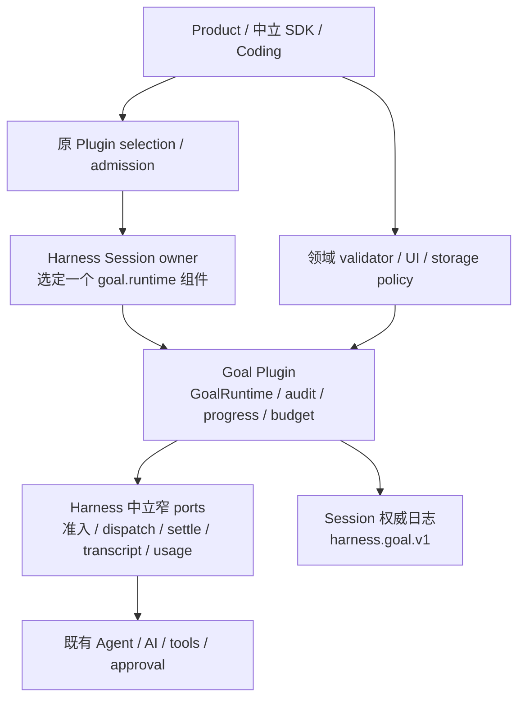

# Goal 插件设计与实施方案

## 状态与交付边界

- Authority: proposed — implementation proposal, non-normative
- Design status: proposed
- Implementation status: not-implemented
- Owner: Harness Session / Goal capability；跨界合同由 Loushang architecture 协调
- 日期：2026-10-16；方案版本：GP-R2（三路初评后的固定复核输入）
- Current 基线：本地 `main` `8f7ce44631ae62ce5335620e6ca93d12e651c132`；未声明与远端同步。
- 方法咨询版本：本地 archmethod `master` `0f9bd3ff51afabeaaf76cc38dff1ceb279b7d37e`，咨询时干净；不变更项目已采用的方法版本。

本次交付为完整 Goal 插件重新设计及三个独立视角评审，不包含插件代码实现、运行激活或发布。下文所有新增类型、路径、事件、测试均为拟议。评审通过表示方案可供实施，不表示功能已存在，也不自动接受为 Target。

## 1. 目标与替代关系

用户要求按插件形态重做 Goal 方案。目标是提供可独立启停、升级和诊断的完整行为插件；Harness 提供产品中立的契约与不可绕过执行保障，Coding 只是消费者。无 Coding 的最小 Harness 应用也必须跑通 create → 自动跨回合推进 → pause/resume → evidence audit → settled → complete。

本方案替代 [2026-10-15 R3](2026-10-15-goal-command-plan.md) 的 Coding GoalService 归属与“等第二个产品再下沉”选择；原文件及原评审保留为历史证据，其评审结论不自动覆盖本方案。R3 中完成候选、最终派发许可、用户输入优先、用量缺失和导航 epoch 等不变量在本方案中完整保留并重新评审。

[Harness 重构原则](../architecture/harness/refactoring-principles.md)允许独立的中立契约 probe 代替第二个生产消费者。[Plugin Architecture](../architecture/harness/plugin/architecture.md)区分能力所有权、插件身份、分发、执行拓扑和生命周期。Goal 的 Harness 所有权与插件交付可以同时成立。

## 2. Current：已有能力与缺口

| 责任 | 当前证据 | 本方案复用 / 缺口 |
| --- | --- | --- |
| 命令与呈现 | [command_pack.py](../../../src/loushang/harness/session/command_pack.py)、[catalog.py](../../../src/loushang/harnesstui/commands/catalog.py) | 复用命令描述与 dispatch；缺 Goal 命令及状态投影 |
| 队列 | [queue_controller.py](../../../src/loushang/harness/session/queue_controller.py)、[turn.py](../../../src/loushang/harness/runtime/turn.py) | 复用 steering/follow-up/next-turn；缺覆盖宿主执行和全部队列的原子空闲准入 |
| 应用输入 | [application_input.py](../../../src/loushang/harness/session/application_input.py) | 复用应用消息；`trigger_turn` 本身不能证明空闲准入 |
| 事件 / 恢复 | [agent_event_router.py](../../../src/loushang/harness/session/agent_event_router.py)、[events.py](../../../src/loushang/harness/extensions/events.py) | agent_end 后仍有 retry/compaction；缺 settled 后的统一 idle 通知 |
| 持久化 | [session.py](../../../src/loushang/harness/transcript/session.py)、[unit_of_work.py](../../../src/loushang/harness/transcript/unit_of_work.py)、[writer_lease.py](../../../src/loushang/harness/transcript/writer_lease.py) | 复用 ExtensionData、提交和 writer lease；缺 Goal reducer/schema |
| 模型输入 / 用量 | [model_call.py](../../../src/loushang/harness/session/model_call.py)、[model_usage_types.py](../../../src/loushang/harness/transcript/model_usage_types.py) | 已有 committed Model Input 与 attempt usage；缺 goal_id 归属、预算和缺失用量策略 |
| 执行收尾 | [execution_guard.py](../../../src/loushang/appservice/execution_guard.py) | task 完成与 settle 分离；不可用 task.done 认定可续跑 |
| 持久 Work | [HarnessWork 架构](../architecture/harnesswork/README.md)、[session.py](../../../src/loushang/harnesswork/integrations/session.py) | Work 有独立终局；Goal 不能重定义 Work success |
| Plugin 类型系统 | [contribution_types.py](../../../src/loushang/harness/resources/plugins/contribution_types.py) | 已有封闭 V2/V3；没有 session_goal，需新协商版本，旧规则不变 |
| owner component | [component_contracts.py](../../../src/loushang/harness/capabilities/component_contracts.py)、[owner_component_host.py](../../../src/loushang/harness/capabilities/owner_component_host.py) | 已有精确组件构造/退役框架；缺 Goal slot、validator 与窄导入 API |
| Session bundle | [session_contracts.py](../../../src/loushang/harness/capabilities/session_contracts.py) | 当前 v4 sealed；没有 Goal facet，插件不得替换整个 Session Provider |

源码和测试中尚未发现实现 `/goal`、`create_goal`、`get_goal`、`update_goal` 的产品入口。当前已有的 Codex goal 执行笔记不构成该功能。

## 3. 要求、范围与可观察结果

| ID | 要求 | 交付验收 |
| --- | --- | --- |
| G01 | 显式设置、查看、编辑、暂停、继续、清除；一个 Session 一个当前 Goal | TUI 与 headless 同一服务；非法输入不启动模型；未完成目标不能被模型覆盖 |
| G02 | 目标、状态、预算、进度跨压缩和进程重启保存 | replay 得到一致 snapshot；摘要不能改变 Goal |
| G03 | 回合 settled 后自动推进；用户输入和既有维护工作优先 | 并发测试只出现一个被准入 turn；忙时无循环重试 |
| G04 | 暂停、清除、Esc、切换、退出可阻止后续自动执行 | 返回后无新目标执行；已有副作用有明确收尾责任 |
| G05 | 保留原目标，完成有逐项证据；阻塞可说明与恢复 | 缺项拒绝 complete；完整审计可回查；阻塞恢复重置计数 |
| G06 | 可选 token 预算、明确计费范围、幂等记账 | 重复 usage 不重复收费；缺失可见；达到预算不发新请求 |
| G07 | 恢复不自动重复外部动作，旧工作区仍可使用 | 崩溃窗口逐一测试；无 Goal 的历史不迁移、不重置 |
| G08 | Goal 不授予新权限，不绕过工具 approval / sandbox | 原策略仍执行；提示注入不能改权限或其他 Session 状态 |
| G09 | 可诊断续跑 / 停止原因，UI 状态来自服务端事实 | 显示目标、状态、预算、最近进展、停因；断线重连收敛 |
| G10 | 与 Work/Method 边界一致，分阶段仍交付完整纵向链路 | 普通 Goal 无需 Method；Work 终态不直接当 Goal 终态 |
| G11 | 真正受管 Plugin，完整独立启停/更新/退役；单 Session 单 Goal writer | 安装成功、选中、激活、退役分别有 receipt；禁用与删除数据分开 |
| G12 | 不依赖 Coding 即可执行完整生命周期；启用 Goal 不增加领域权限 | 独立中立应用通过完整纵切，import graph 不含 Coding/Method/Work/UI |
| G13 | 旧 Plugin 及 Session 兼容，新旧 schema 不互相污染 | 旧 V2/V3 golden 不变；缺插件/旧 host 只能停目标，仍可读普通历史 |

场景源为用户本次需求与现有运行时约束。长期无人值守、团队共享 Goal、定时唤醒、多目标并行、跨设备自动接管不在此命令首版范围；这些排除不减损会话中自动跨回合执行、持久化和可恢复能力。无预算表示用户未设 token 上限，仍受权限、停机和反空转约束。

## 4. 选择：Harness 所有的完整 Goal 插件

| 方案 | 判断 |
| --- | --- |
| Coding 自管 Goal | 已被用户要求替代；完整通用生命周期不应依赖 Coding |
| Harness 固化全部实现，插件仅提供开关或提示词 | 无法独立版本化/退役实际行为，不满足本次插件目标 |
| 普通 Native Extension 在 agent_end 发继续 | 无法证明 whole-call settled、原子准入、Package 生命周期；不选 |
| Goal 独立进程/第三方 Worker | 需新增控制 IPC、containment 和崩溃协议；当前 read-only Worker 路由不具该能力；首版不选 |
| Harness 契约 + Session owner-component + 第一方进程内 Goal Plugin | 选择；GoalRuntime 全部放入插件组件，执行仍由原 owner 承担 |



### 4.1 所有权与唯一实例

| Owner | 拥有 | 不拥有 |
| --- | --- | --- |
| Harness Session / Goal 契约 | 中立 Goal 类型/schema、slot/Consumer、组件 admission/publication/retirement、generation lease、宿主安全约束、只读 unavailable 投影 | 第二个 agent loop、Coding 语义、用户目标内容 |
| 受准入的 Goal Plugin 组件 | 唯一 GoalRuntime；目标状态迁移/reducer、持久记录、续跑决策、通用提示模板、进展/阻塞、预算派生投影、完成审计、命令/工具实现 | 任意工具权限、直接写原始 usage、原 Session/Work 生命周期 |
| Harness 执行与持久底座 | 中立 start_if_idle、final dispatch permit、用户优先、approval/sandbox、取消与 settle、transcript 原子提交、原始 attempt 事实 | 产品专属验收内容、替插件推进目标状态 |
| Product（Coding 等） | 插件选择、已授权 binding、领域 validator、存储根/保留策略、界面集成；必要的 Method/Work adapter | 第二份 GoalRuntime、Goal 通用 scheduler 或 reducer |
| Plugin 管理 | Desired installation/selection、版本/信任证据、退役请求/状态聚合 | 发布 Session generation、写 Goal 状态、回收 Session 日志 |

Harness 所有的是契约及组件的精确 owner；运行时唯一 Goal writer 是该 owner 发布的插件组件，不另设常驻核心 GoalRuntime。插件可以调用自身分发内的实现模块，但不得 import Coding/Method/HarnessWork/UI/provider 内部。通用目标与默认审计无需 Product 注入 Coding validator 即可工作；领域 validator 只能增加证据，不能豁免预算、许可、settle 或缺项审计。

建议 Harness 协议放在拟新增 `harness/session/goal/`（contracts、component、host binding、read view）；默认插件首版以独立 artifact 内一个完整 `goal_component.py` 执行模块交付，实际包含 runtime、reducer、continuation、accounting、audit、commands/tools 和默认模板。插件以一个 Package + manifest/Definition 声明交付，具体发行名 `loushang-goal`、Plugin ID `loushang.goal.default` 是候选，不是已注册 ID。`coding/goal/` 不再拥有通用运行时。集中模块不等同于新增顶层 Architecture Scope/Capability，避免逐类建 registry/factory。

### 4.2 Session 内的组件与最小 ports

新组件 kind 暂定 `goal.runtime`，owner 为 `harness.session`，仍处于同一 Session graph，不新增 `harness.goal` 图节点。Goal 未启用时不请求该 slot，不新增空 writer；启用时 slot 使用现有 `exclusive/exactly_one/minimum=maximum=1` Definition。不能把现有 exclusive Definition 写成 minimum=0。多个候选由显式选择决议，冲突拒绝，不用加载先后决定。

Session bundle 的候选新版本固定为 v5，新增 `interaction.goal` facet；v4 Definition/Provider 与原 Requirement 合同原样保留。一个 Runtime 的图中同一 capability_id 只选一个版本，不同时挂载 v4/v5。未选择 Goal 的原路线继续 v4；显式选择 Goal 使用 v5，并要求其全部实际依赖者先完成 v5 兼容核对。当前 maximum=4/exact(4) Consumer **不能**直接捕获 v5；必须由原 owner 为已验证未变 facets 扩展相应 Requirement 范围或显式提供 v5 adapter，不能忽略版本检查。v4-only consumer/host 对 Goal 选择返回 incompatible/restart_required，不静默挂载。v5 Provider 声明的 facets 必须与实际 BundleValue 一致；Goal 未选时不捕获 goal facet。P0 列清 model_input、Session facade、Workspace Consumers、SDK 的所有 Requirement 升级点及逐项兼容证明。`interaction.goal` 暴露 command/get/subscribe 的 lease-aware Consumer，不泄漏原始 Graph、Store、Agent 或插件对象。可见性与挂载资格分别判断；不存在 facet 时返回 unsupported。

兼容矩阵（未来验收）：

| 实际 composition / Consumer | 决议 |
| --- | --- |
| 旧 v4 Provider + 原 max4/exact4 Consumer，无 Goal | 原路成功，旧数据/Plugin 行为保持 |
| Goal v5 Provider + 已验证并显式升级 Requirement 的 Consumer | 新路成功，facet绑定验证继续由原 Graph执行 |
| Goal v5 Provider + 未升级 max4/exact4 Consumer 或 opaque旧Plugin | capture/admission 拒绝 incompatible；必须更新该消费者或使用原无Goal composition，不能忽略检查 |
| v4 Provider + 请求 interaction.goal 的新 Consumer | unsupported，不能伪造空 Goal provider |
| 未知 Session版本 / Index-IR-document tuple / requiredFeatures | 明确不兼容；不执行 Goal，已有旧 composition不被自动改写 |

P0/P1 的变更必须同时覆盖原 typed Consumer 对 Requirement 等值的校验、Provider metadata 和 ModelInput根依赖；仅改一个 maxVersion 不是兼容证明。新旧 composition 由原 Product selection显式选定，不能为修错在一个图挂两份 harness.session。

组件构造仅注入：

| Port（拟议） | 权限范围 |
| --- | --- |
| GoalRecordPort | Session 绑定 namespace 的 read/append/CAS、固定 operation reconciliation；不传 Store 根或 writer 对象 |
| GoalExecutionPort | 调用同一宿主 execution admission、取消、settle receipt、事件订阅；不暴露直接 prompt/run_agent 绕路 |
| GoalDispatchPort | 原 owner 维护的 opaque fence/ticket、readonly budget directive 绑定；不允许插件自授许可 |
| GoalUsagePort | 原始 usage、expected-attempt/outcome 的只读精确身份；不改共享账 |
| GoalInputPort | 可信 GoalIntent、input/admission/navigation epoch；不能铸造原始用户授权 |
| GoalContextPort | Session-owned lease-aware request contribution 注册；插件仅返回受控数据/模板，宿主决定归属、排序并提交 Model Input |
| GoalEvidencePort | 中立 evidence refs 与可选已准入 validator；无 Coding 对象 |
| GoalPresentationPort | 中立 snapshot/receipt/固定本地结果；不访问 TUI |

插件拥有策略与可重建派生状态；宿主 final admission 消费版本化预算/fence directive 并检查当前 lease。组件不可用、directive stale 或 finite-budget accounting unknown 时禁止新 Goal dispatch。第一方 in-process 代码具有已证明的 host-equivalent trust，窄 ports 是边界契约，不宣称能隔离恶意同进程 Python。

ports 是权限分组，不是八套服务或 registry。组件使用 owner 注入的当前 Session 窄引用；不能声明对自身 `harness.session` 的 Graph self-edge，也不能依赖上层 model_input 节点形成环。构造时 ports 处于 staged，不可启动执行；原 Session/Model Input 完成既有 Graph publication 后才开放 live 调用。

**每次请求上下文贡献合同。** Goal Plugin 在 GoalContextPort 注册一个绑定组件 lease 的 contribution；注册、适用选择、排序和撤销都由现有 Session/request-context owner 持有，不另建 registry。请求输入包含不可变 execution_origin、goal attribution、purpose、goal/control/snapshot revision、input/navigation epoch 与 source refs；插件输出 `GoalContextContribution(template_id/version, objective/requirements/budget/progress refs, content, binding_digest)`，不接受 Agent/committer 或原用户文本修改权。Session owner 在每次 Agent convert_to_llm/prepare_model_call 形成最终上下文之前组合贡献，冻结输出并使真实 transport 和 committed Model Input 引用同一份内容/绑定；不能只在自动继续 prompt 上附加文字，不能让只返回 CallOptions 的现有 preparer承担内容注入。

普通 Goal-bound turn、同轮后续 sampling、retry 都注入执行目标；Goal 归属的 compaction 请求使用 data-only 目标/证据保留约束，不注入新的执行指令，重建后下一 sampling 重新投影 snapshot。独立 side_question 不获得 Goal 执行指令、mutation 或 accounting attribution，即使复用父 callbacks 也由明确 purpose/attribution 排除。owner commit 与最终 dispatch 核验 context binding、输入/导航/control epoch 和组件 lease；stale 丢弃准备结果，不发请求。退役/revoke 同步使 contribution 资格失效，后续 sampling 不得沿旧闭包继续；已准入请求仍按原归属记账。V13/V18 增加压缩后普通 prompt、同轮后续调用、retry 以及独立 side-question 的实际 Model Input 断言。

整个 live Session/generation 只由 Session owner 构造一个组件。重连复用 Consumer；内容刷新不能再次创建组件。sealed Session 首版不热换 GoalRuntime：新选择对新 Session 生效，已有 Session pin 精确旧 revision。组件 disposer 必需；退役与执行收尾规则见 §13。

### 4.3 Plugin 声明与装配，不伪装现有路由

当前声明 kind 不含 Goal。拟新增 owner 专用 `session_goal` contribution，对应 `goal.runtime`；不能借 `continuity_provider` 冒充，也不能用局部 `capability_provider` 替换整个 Session bundle。新增候选 tuple 为 Contribution Index v4 / declaration IR v4 / document v3，manifest v1 / engine API v1 的原字段不变，通过新 feature `session-goal-component/v1` 显式协商；不含该 feature 的稳定旧路线仍使用原 tuple。此 tuple 为本方案待实施合同，无协商/未知 kind 拒绝执行 Goal。当前 V2/V3 的 closed kind 集和字节 golden 保持不变，不能修改全局 kinds 集导致旧 schema 也要求新 arm。

装配路径：inert manifest/index → 原 Package verification / trust / selection → 原 declaration host → Session-owned typed adapter → CapabilityComponentAdmission/Selection → 原 CapabilityOwnerComponentHost 构造 exact payload → Session owner 发布组件 → 生成命令/工具/Consumer binding。Owner payload validator 与 factory/disposer 都核对精确 package digest、dependency lock、config、scope、owner generation 和 revision。

首版采用经宿主单独证明 host-equivalent trust 的第一方 in-process 插件；名字/签名/first-party 标签本身不授予信任。不开放第三方 Goal Worker、远程服务或任意本地 Extension 的 Goal 控制权。现有 Component Host 窄 import API 需显式增加 Goal 合同所需 symbol，不放开整个 Harness/Coding 导入。首版显式遵守当前单文件 verified loader：factory/disposer 都指向同一 `goal_component.py` 中的符号，执行模块只导入被允许的标准库和拟新增 exact ABI `from loushang.plugin.goal_runtime import <allowed names>`，不作相对导入/绝对自身包导入，不从 ambient sys.path 加载其他实现，不把完整 runtime 移回 core 作 alias。模板首版为该模块中的版本化静态数据。多模块 artifact loader 是后续独立提案，不作为首版隐含前提。

新的 runtime ABI 仅导出 Goal 值对象、协议和 contribution/receipt 类型；Host 显式列 symbol allowlist，不开放 `harness.session` 或 `loushang.plugin` 大前缀。公开 author v1 的现有 helper/golden 不变；首版新 artifact 用明确 v4 inert JSON 声明，现有 package/validate 编译链增加该版本 codec 与 feature 支持；不凭旧 capability_provider helper 产出新 kind，也不以内部测试 fixture 冒充稳定 author SDK 已有能力。独立应用测试必须从该实际 artifact 经原声明/Component Host 装配。

插件主要只有一个有行为的 session_goal 组件；命令/工具描述由此组件提供并交给既有 Catalog owner 绑定，通用模板随 artifact。若需要独立 Resource contribution，必须有单独 owner receipt，不能假装跨 owner 原子事务。Session usability/publication barrier 仅在所需组件、catalog bindings 和 Consumer 资格都可用后开放；局部发布失败撤销已发布资格并保留 cleanup debt，不允许悬空命令启动执行。插件未启用不影响普通 Session；用户明确选择 Goal 而挂载失败必须显式失败，不静默退回无 Goal。

### 4.4 Goal、Work 与 Method

Goal 是会话级结果契约；WorkRun 是一次执行承诺，Turn 是一次模型交互。一个 Goal 可关联零到多个 WorkRun，Work success 只提供证据。用户 enact Method 时仍由原 Product preparer/executor 与 HarnessWork 冻结 contract 并拥有 run/step/deviation/terminal。插件只接收 opaque run/evidence refs，不 import Work/Method，不复制正式 plan，不改历史 Work 终态。

## 5. 状态、权限和命令合同

拟议公开状态：`active / paused / blocked / usage_limited / budget_limited / complete`；没有 Goal 用空 snapshot 表达。`complete` 对该 goal_id 不可逆；重新开始创建新 ID。`budget_limited` 可在用户增加预算后恢复；与 complete 的含义不同。`blocked` 同时承载业务阻塞和带 reason_code 的运行时熔断，不表示任务完成。

| 操作 / 起点 | 结果 | 授权与副作用 |
| --- | --- | --- |
| create：无 Goal 或 complete | active，新 goal_id | 仅显式用户命令或本回合可核验的明确请求 |
| view：任意 | 不变 | 不发模型请求 |
| edit：未完成 | paused，revision + 1，保留 goal_id / 既有用量 | 用户显式提交；旧 invocation 全部 settle 后才能 resume；重置进展/阻塞计数；验收条件变化有历史 |
| replace：未完成 | 新 active、新 ID、旧目标 archived | 仅用户显式 replace；一个原子记录，不先 clear 后 create；旧执行先 fenced 并 settle |
| pause：active | paused | 用户控制；撤销待续跑；取消当前全部 Goal-bound 执行并完成收尾；独立用户执行遵守下面的归属表 |
| resume：paused / blocked / usage_limited | active | 用户显式请求；权限和运行时可用性复核；阻塞计数清零 |
| resume：budget_limited | active 或拒绝 | 仅用户提高预算或显式取消上限后，且已用量小于新上限 |
| clear：任意 | 当前 Goal 为空，追加 tombstone | 用户控制；fence / settle 同 pause；审计历史仍保留 |
| request_complete：active | active + completion_pending 投影 | 工具只保存完成候选并返回，不等待自己 settle；唯一服务在 §9 条件满足后 CAS 提交 complete |
| 系统熔断：active | blocked / usage_limited / budget_limited | 原因和事实由代码记录；不得假装完成 |

执行来源、费用归属、执行许可分别保存，不能靠去掉 attribution 绕过预算：

| execution 类型 | pause / clear / edit / replace | budget/usage limit | 迟到费用与状态 |
| --- | --- | --- | --- |
| 自动续跑或明确推进 Goal 的用户执行（Goal-bound） | 统一撤销新 dispatch 许可并取消/settle 当前执行及所属后代，不因来源是用户而豁免 | 同样受 Goal 预算与熔断控制 | 仍归原 goal_id；不能 mutation 新目标 |
| 显式独立 side question / 无 Goal attribution 的普通用户执行 | 不取消；但当前 Goal 的 mutation 和自动续跑不能混入该执行 | 不消费 Goal 预算；仍受全局 provider/权限限制 | 单独记原有 usage，不转移已有 Goal 费用 |

当前 Goal active 时，普通推进任务的 prompt 默认 Goal-bound；独立 side-question 必须走明确的现有 side-question 路由，不能由模型事后把昂贵步骤改称独立任务。paused/无 Goal 后新普通 prompt 可以独立执行，但不恢复目标、不能为其提交完成。控制表指全部 Goal-bound 执行，并非取消 Session 中每一个用户操作。

默认归属使用 effective Goal authority，不直接读 persisted status：只有 active 且组件已挂载、lease/current intent 可用、无 recovery/quarantine/retirement 阻塞时，普通推进 prompt 才默认 Goal-bound。raw active + unavailable 时普通 prompt 仍可作为独立会话执行，宿主在提交前显示/输出“Goal 不可用，本请求不推进该目标”，receipt 明示 attribution=none；不得使用不可用插件的 context、validator 或费用转移。显式 Goal resume/推进控件返回 goal_unavailable，不降级成普通 prompt；独立 side-question 继续独立。该规则由宿主已知 envelope+lease 实现，不调用缺失/撤权插件 reducer；新独立执行不能 mutation/complete 旧 Goal，已发旧调用仍归原账。V17 包含真实普通 prompt、显式推进拒绝与重新启用后的恢复归属。

暂停/清除的“停止未来自动启动”在控制记录提交时生效；“收尾完成”在 execution settle 后生效。同步客户端等待收尾；异步客户端收到 stopping 投影和操作 ID，最终 settled receipt 才表示收尾成功。`stopping` 是控制操作投影，不新增 Goal 公开状态。外部动作已成功时如实记录，取消不承诺回滚。清除后迟到 usage 仍归旧 goal_id 的归档账，不写进新 Goal。

命令统一经 typed session command dispatch：

```text
/goal                              查看；无目标时显示用法
/goal <objective>                  创建；未完成时提示明确使用 replace
/goal set [--token-budget N] -- <objective>
/goal edit -- <objective>          编辑后暂停，保留历史用量
/goal replace [--token-budget N] -- <objective>
/goal pause
/goal resume [--token-budget N | --unlimited]
/goal clear
```

保留字作为目标可用 `set -- pause`。预算只接受正整数，拒绝 bool/零/负数/溢出；不接受模型自行推定预算。空目标、超限目标（首版建议 UTF-8 64 KiB，可配置）和非法选项在任何状态写入或模型请求前报错。`edit` 后保留原预算，不能绕过累计用量；complete 只能新建。ephemeral/read-only Session 返回不支持持久 Goal，可继续普通 prompt。首版不隐式读取目标文本里的路径或 `@file`；文件上下文仍走原有用户输入路径。

模型工具拟议：`get_goal()`、`create_goal(objective, token_budget?)`、`update_goal(status, expected_goal_id, expected_revision, audit?)`，另有 `report_goal_progress(expected_goal_id, expected_revision, progress)` 提交回合证据。update 的 complete 是提交候选，不是立即终态。create/paused 必须匹配宿主独立 GoalIntent，update 只允许 complete/blocked/paused。模型不能 resume、改预算、clear、replace 或写任意 Session。工具身份从绑定读取，参数不能指定其他 Session。工具可见性不是权限校验，handler 再校验身份、generation 和权限。

### 5.1 首版入口与 headless 运行寿命

以下为拟议语法，尚未实现。嵌入式 TUI 使用上述 slash command；单次 CLI 增加 `--goal-command` 和 `--goal-output text|json`，与 positional prompts 互斥，例如 `loushang --resume <id> --goal-command '/goal resume' --goal-output json`。无 `--resume` 的 create 使用既有新 Session 流程；不支持 ephemeral。解析后直接调用相同 typed service，不把 slash 文本再发给模型。Goal 插件经 Session owner 的现有 descriptor/executor 组合贡献通用命令；Coding 只选择该贡献与适配 CLI。Goal 控制 API 同时供中立应用使用。

- 本地单次 CLI 的 create/replace/resume 默认持有 Session writer 和事件订阅，直到 Goal complete、paused、blocked、budget_limited、usage_limited 或被 clear；不能第一轮返回就沿旧 plain_prompt_host 的固定 prompts finally dispose。view/edit/pause/clear 等控制操作在其所需 receipt/settle 返回后退出。
- 此 CLI 首版无 detach/no-wait 运行模式；不启动隐式后台服务。Ctrl-C 先 fence 再 abort/settle，最终输出状态并退出；强杀后按恢复规则处理。非交互 approval/question 没有可用回答通道时，立即停止为 blocked(interactive_input_required)，不能循环等待三轮或假设批准。
- 嵌入式 SDK 的 GoalCommand 返回 receipt，Goal lifetime 由当前 Session owner 保持。hosted 长连接使用拟议 capability-negotiated GoalCommand/Get/Subscribe 数据协议；服务端控制身份从现有 binding/scoped attachment 取，执行仍走原 hosted owner。未协商的客户端返回 unsupported，不能降级成普通 prompt；连接 detach 与宿主 close 分开。
- 结构输出区分 `command_receipt` 与 `goal_result`。本地运行到 complete 退出 0，paused/cleared 退出 3，blocked 退出 4，budget_limited 退出 5，usage_limited 退出 6；参数/unsupported 退出 2，运行/存储失败退出 1，Ctrl-C 成功收尾退出 130。view/明确 pause/clear 的控制命令成功为 0，不把“控制成功”解释为任务完成。cleanup debt 显式返回失败及 operation ID，保留恢复记录，不能输出成功收尾。

### 5.2 最小数据与权限协议

P1 定义 typed `GoalCommandRequest(operation_id, expected_goal_id?, expected_revision?, kind, payload)`；Session/actor/generation 从可信 binding 取。`GoalReceipt` 包含 operation_id、goal_id、control_revision、record_id、disposition（committed / already_committed / pending_settlement / rejected）、snapshot_revision、reason_code 和 execution_refs。模型控制 handler（含 paused/blocked）不得等待自己所在 execution 收尾，只返回 pending receipt，由原 owner 结束执行并发最终事件；外部同步客户端才可等待最终 receipt。失败码至少为 invalid_input、conflict、unsupported、unauthorized、storage_unknown、settlement_pending；同幂等键不同 payload 是 conflict。无目标 clear、重复 pause 返回幂等 receipt，complete 的 resume 明确拒绝。

GoalIntent 是拟新增的宿主中立输入权限凭证，含可信 actor/channel、原始 request ID、Session generation、允许的 mutation、objective/预算摘要及撤销/消费状态。它由 typed 用户命令、SDK 显式 Goal 操作或受信输入适配器识别的原始用户明确请求产生；原始输入须在 extension transform 前锚定。自然语言歧义时只生成 draft，不启动 Goal，等待明确 Goal 操作。模型只能消费已绑定 intent，不能自填授权证据。Resource/Skill request_evidence 只用于来源追溯，不是该凭证；application message、工具结果、历史对话和扩展改写不能铸造 GoalIntent。当前没有 intent adapter 时隐藏模型 create/paused 工具能力，CLI/TUI typed 命令仍可用。

初次 goal record 保存 `RequirementSet(revision, objective_digest, items[id, original_anchor, acceptance, constraints])`；原文锚点必须覆盖完整目标，拆解只是模型提议，宿主不能据删减列表宣称完成。后续建议作为新 analysis record，不能删原要求；改变用户目标仅经 edit。`GoalProgress(execution_id, classification, evidence_refs, next_action?, blocker_fingerprint?, wait_ref?)` 在每轮 settle 前提交候选，之后关联最终执行事实；`GoalAudit` 的结构见 §9。repeat/stale 提交用 operation_id/expected control revision 校验。control_revision 只随用户控制/目标语义/终态变化；usage/progress 只推进 snapshot_revision，避免记账不断使控制候选无故 stale。

## 6. 持久数据、分支与版本

复用现有 transcript UoW / writer lease，通过 Harness-owned `ExtensionData` 命名空间存 Goal 事件。拟议 `harness.goal.v1` envelope 包含：`schema_version, operation_id, session_id, goal_id, revision, event_kind, expected_revision, payload, actor_ref, source_request_ref, plugin_revision_ref, component_generation, timestamp`。单条提交构成控制变化的原子边界，成功 receipt 后才发布 UI 事件。重试按 operation_id 幂等；同 ID 不同 payload 拒绝。

reducer 产生 `GoalSnapshot`：目标全文、约束/验收条目、状态/停因、预算/known_tokens/budget_usage_quality、累计 active elapsed、最近进展与阻塞 streak、control/snapshot 两种 revision、待收尾 execution_refs、continuation claim 和审计引用。时间用进程内 monotonic delta 持久化；离线时间不算执行耗时，不宣称精确成本或账单。

- Goal 属于 Session，按所有已提交控制记录的顺序 replay，不按 active conversation path 重建；切换历史 branch 不撤销已提交 pause/clear/budget。目标验收标注所选历史 lineage、显式 navigation_epoch 和 source_cursor 证据锚点。navigation_epoch 只在用户显式历史导航/branch selection 时变化，正常 append 不改变它；source_cursor/leaf_id 随追加推进不等于导航。显式导航变化使未终结目标的完成候选失效：active 变 paused；paused/blocked/usage_limited/budget_limited 保留原停因并要求重新审计，budget 限制不能被换分支解除。已 complete 保持不可逆终态及原 branch/cursor 的历史审计，UI 标注其适用范围，不将历史完成结论推广到当前分支；要重验应新建 goal_id。
- 新 Session 不继承 Goal；fork/clone/import 默认不继承 Goal 执行权威，具体转换见下面矩阵。旧 Session 保持自身状态。
- 压缩只重写模型上下文投影，不能丢控制记录/用量；每次模型输入都由当前 snapshot 重新注入目标引用和版本，并进入既有 committed Model Input。
- 目标设置、清除、replace 在一个现有 writer lease 下顺序提交；多个客户端使用 CAS revision。派生 snapshot/cache 可重建，不维护第二份 authoritative JSON/SQLite。
- 未知 schema 不执行目标，给出可恢复诊断；不破坏普通会话读取。旧工作区无命名空间时自然解释为空。回退版本保留原始 ExtensionData，关闭 Goal 自动执行；实施阶段必须用实际旧版本验证其可读与往返保留，不能仅凭“扩展字段应被忽略”作承诺。
- 不修改机器消费的 Session header。event/schema 若触及既有兼容契约，实施时先提交对应共同父级 ARD；本方案不以改 header 为前提。

### 6.1 分支、fork 与导入导出转换矩阵

共享 transcript 的现有 export/fork 可能只复制所选 branch；Goal 不能假定它们会带全 Session 控制记录。本方案选定：**副本默认不继承 Goal；历史 namespace 不直接成为新执行权威**。

| 操作 | active / 其他未终结 | complete | cleared / 无 Goal | unknown schema |
| --- | --- | --- | --- | --- |
| 同 Session branch switch | 按上面的状态规则停止自动推进、废弃候选；不按旧 branch 恢复状态 | 保持 complete 和历史审计 | 仍无 Goal；旧 create 不复活 | 停止 Goal，普通历史可读 |
| fork/clone 到新 Session | 默认无 Goal；显式 copy-goal 才从源 Session 当前全序 snapshot 生成新 paused Goal、新 ID、零新账和 provenance | 默认无 Goal；显式 copy-goal 创建 paused 新 ID，旧完成只作参考 | 无 Goal，即使所选 branch 有旧 create | 禁止 copy-goal，只保留历史诊断 |
| JSONL / bundle 导出 | 使用现有分支导出，但 Session export adapter 从导出记录剥离 Goal control namespace，保留其他记录，给出 Goal 未导出提示 | 同左；审计不被冒充当前控制状态 | 同左，避免遗漏 tombstone 后复活 create | 对 Goal namespace 做 opaque 剥离，不猜内容；提示无法迁移 |
| JSONL / bundle 导入 | 保持现有通用 header/session 身份语义，不声称 import 天然新建 Session；所有历史 Goal namespace 均隔离为非权威，只能经受准入的 Goal 插件显式重新设置 Goal | 历史完成可读但不授予当前 Goal 控制 | 当前无 Goal | 目标不执行，普通会话照常导入 |

Session 生命周期 adapter 在 writer/runtime publication 前完成导入/fork 的 namespace 处理，不能等 GoalRuntime 第一次启动时才 append 一条覆盖记录；失败则不发布新副本。现有目标 Session 的 writer conflict 按原机制拒绝，不能 import 合并覆盖当前 Goal。文件级备份恢复同一个原始 Session 的完整 authority 是另一条显式恢复路径，仍按 §7 先暂停；不能与普通 branch export/import 混用。

显式 copy-goal 若有 evidence ref 不在副本中，只保留 opaque provenance，不当成 proved；首版不复制 audit candidate、执行 claim 或旧费用。fork 到目标创建前的 leaf 也只可在显式 copy-goal 时复制源 Session 当前 snapshot，必须在 receipt 明示 source goal/cursor 和新目标 paused，不由历史 leaf 猜目标。旧版本产生的分支副本在新版本导入时也执行隔离策略。V02/V12 必须覆盖 clear 在非所选路径、fork 到 create 前、两种导出格式、旧版往返和 unknown schema。P0 要验证当前 export/import adapter 的真实 hook，以上外部选择已固定，不能以 spike 留白替代。

## 7. 原子续跑、取消与崩溃恢复

缺失的基础合同拟由 Harness Session 补充，名称暂定 `start_if_idle(request, expected_session_generation, expected_input_epoch)`、`on_execution_settled` 和单调 `admission_epoch` 变更通知。只暴露执行来源、队列/维护/收尾状态和准入结果，不含 Goal 类型。P0 必须区分外层 `CodingHostedExecution` 的 `ExecutionGuardV1` 与内层 Harness `HostRuntime`：hosted 自动目标执行必须先经同一外层 guard，不能直接 prompt 绕过它；外层到内层以 Product adapter/中立条件组合，Harness 不反向依赖 AppService/Coding。嵌入式与 CLI 同样只保留各自既有 execution owner。P0 给出所有入口到最终 settle 的实际调用链和唯一准入 owner，再决定窄 API 的物理位置。该接口由现有 execution/queue owner 实现；GoalRuntime 只有策略、claim 和事件订阅，不拥有第二条 run 队列。

必须共同检查：无活跃 invocation、全部用户/应用/steering/follow-up/next-turn/mailbox 队列为空、无 admission 中的用户操作、无 retry/compaction/recovery、无 approval/pending questions、无 cleanup debt、Session generation 仍有效、宿主不是 plan-only / disposing / switching。队列与宿主准入共享线性化点。`agent_end`、`turn_end` 和单个 Task.done 均不足以触发续跑。

续跑流程：

1. settled / queue-drained / explicit resume / admission_epoch 变化唤醒一次评估；先处理用户工作，再查 Goal active、预算和停因。
2. GoalRuntime 在自身短控制锁中取得 control revision 并提交 continuation claim（含目标版本、输入 epoch、上次 execution_id）。单一 writer 下每个目标版本最多一个未解决 claim。
3. 调用宿主 start_if_idle；原子取得执行所有权后，在发模型请求前复查 Goal fence、状态、generation 和 epoch，并提交实际 execution_id/Model Input 关联。任何不匹配取消 claim，不发请求。
4. Busy/stale 只记录原因并等待下一个真实状态变化，不轮询重试。Started 将 receipt 投影给 UI；本轮结束且 settle 后，持久化 usage/progress，再评估下一轮。
5. 用户在准入前到达则拒绝自动执行；准入后到达则走现有 steer/follow-up，按其原策略处理。pause/clear 的 fence 在每次模型/工具的最终 admission 校验；准确的在途定义见下面 dispatch 合同。

continuation claim 显式状态：claimed → started → settled；确定 Busy/stale/not_submitted 则 claimed → released，receipt 持久化后才允许同 control version 新建 claim（新 operation_id、最新 epoch）。started 必须关联实际 execution_id，重复通知只重放同 receipt，不再调用 start。start_if_idle acknowledgement 丢失/异常不能推断未启动：claim 保持 admission_unknown，封新 Goal 续跑，通过 GoalExecutionPort.observe_admission(operation_id) 查询原宿主的确切 started/not_submitted/unknown，不能以超时或缺消息自动重试。只有权威 not_submitted 才 release；started 则观察同一 execution；unknown/debt 等待原 owner reconciliation。崩溃留 unresolved claim 走 recovery_required，不能第二次启动。V03 覆盖 claim 后 consumed input 插入→确定Busy→release→epoch exit→恰好一次新准入；unknown receipt→查询而非重启。该查询为 P0 必须新增/证实的原宿主窄协议，不由插件维护第二套 execution ledger。

Busy/stale 后不能漏唤醒：通用 owner 为输入 admission/interceptor/preflight/command、维护、approval/question 和 cleanup 的所有进入/退出推进 epoch；被消费的命令、验证失败、未启动 execution 的输入、维护拒绝也必须发退出通知。订阅后读取 epoch，评估完成再比较 epoch；变化则合并一次重新评估，消除 lost wakeup，不做定时空轮询。P0 列每个阻塞条件的进入、退出与通知 owner，V03 验证无 execution 的退出路径。

### 7.1 每次外部派发的最终许可

`start_if_idle` 只准入一轮，不能替代同轮工具/模型的许可。拟议中立 dispatch ticket 由原 tool/model execution owner 管理，绑定 execution、Session generation、opaque fence、action/attempt ID。Goal 控制先同步撤销本地许可，再持久提交控制记录；提交未知时保持本地关闭，查询原 operation_id 决议，不回滚开放。

最终许可必须在 approval、policy audit、Model Input commit、retry 等 await **之后**、实际 handler/transport admission **之前**核验，不能复用进入审批前的许可。检查 fence 与登记 action 为 in-flight 在同一短同步临界区完成，不能在两者之间 yield。再交给现有 executor/adapter；approval 仍由原授权链决定。通用接口只接受取消/opaque ticket，不接收 Coding Goal 类型。

线性化点是 final admission，不是网络/文件系统真正完成的时间。已在该点登记的动作即为在途，可能在 pause 提交后才产生或返回外部效果；必须记录 ID、取消并等待 settle。fence 后不能再取得新许可。收到 late allow、await commit 后才抵达 final admission 的旧动作必须被拒绝。stopping receipt 说明仍在途的动作，settled receipt 才说明已无在途责任，不承诺撤销已执行副作用。V04/V07 在 late approval、commit-in-progress、预算与后代 dispatch 竞争点注入交错并核对许可顺序。

锁序：Goal 控制锁保护持久变更和短 snapshot 操作；宿主准入锁只保护队列/执行权。不能持有任一锁等待模型、工具或 settle。跨两者用版本/fence 复核，禁止 control → await execution → control 的等待环。设置和工具 mutation 不在锁内递归发 prompt。

Esc/interrupt 暂停 Goal 并撤销 claim，再调用现有 abort/settle；预算、权限耗尽不被 Esc 改成普通 pause。切换、退出、扩展卸载先阻止新启动，再收尾，最后 release registrations。TUI detach 不销毁仍被宿主持有的 Session，重连只读当前状态；如果执行宿主退出则走下面恢复规则。

恢复：进程重启不扫描所有 Session 启动 Goal。显式恢复 Session 时 replay；残留 claim、active execution 或未证明的 cleanup debt 叠加 recovery_required：此前 active 才转 paused，budget_limited/usage_limited/blocked 保留主状态，complete 保留历史终态，展示在途记录，用户 resume 前必须 reconciliation。禁止重放“可能已发生”的工具动作。清洁 shutdown 已保存 active 的目标也先显示恢复提示，由用户 resume 激活；这是比参考行为更保守的产品选择，保留跨回合自动推进。重启导致无法确认的外部效果由 Product adapter 查询实际状态；无法确认则 blocked，保留证据。

## 8. 用量、预算与反空转

Goal 激活时记录执行基线；仅将此后被准入且绑定 goal_id/control_revision 的主执行、实际 retry、compaction 模型调用和后代执行记入目标。暂停时已发出的请求继续归旧目标；普通独立 side question 不记入 Goal。并行子 agent 必须携带 root attribution；未绑定用量不得默认为免费。

持久 `ModelCallAttemptUsage` 是共享原始事实源；既有 `ModelCallUsageLedger` 的 partial replacement/组件完整度和 total 计算不变。Goal 只做可重建的 attribution + budget 派生投影，不重新计费、不写第二套 usage 事实。Goal 的 `budget_usage_quality=known|pending|unknown` 表示可用于预算的总量质量，与既有 ledger 的 `complete`（终结且所有组件完整）不同，UI 分别命名。adapter 明确声明 total/组件语义，未声明时不自行覆盖共享 ledger；若需改共享算法，另作兼容决定。

从 committed prepared request 和 final dispatch ticket 建立 expected-attempt 集合（包含 snapshot ID），分别记录 prepared/accepted/sent/outcome/usage 状态。无 usage callback、usage 写失败、未确认派发或崩溃窗口都会留下 accounting debt，不能用“未收到一行”推断 0。迟到 usage 依准确 invocation/attempt/snapshot 绑定，不能借 latest-attempt 指针猜测。Goal 账的 expected 集合与原始 usage 关联均可 replay；不遗漏 retry/compaction/后代。

按 `(goal_id, invocation_id, attempt, model_input_snapshot_id)` 保存累计水位；每个 usage snapshot 取非递减增量，终结 snapshot 与中途更新去重，分组件计数绝不再加一次 total。采用 adapter 明确声明可信的 provider normalized total；没有 total 时只使用 adapter 明确声明互不重叠的组件组合。counter 回退/冲突或缺少可靠 total 标记 `budget_usage_quality=unknown`。当前 attempt 进行中为 pending，不阻止该已准入调用的流式观测；当前主执行及全部后代 settle 后，终结观测仍缺失才成为 unknown。需要新派发（含并行子调用）时，只要其他已发 attempt 的未知消耗不能由共享预算 reservation 覆盖，就 fail closed；首版不实现并发 reservation 时，有限预算串行化 provider dispatch，禁止同一额度多次放行。finite-budget 目标在下一次 provider dispatch 前 fail closed，停为 blocked(accounting_unavailable)，可解释已知下限；禁止把 unknown 当 0。新目标不能吞旧目标迟到回执。

达到预算时原子保存 `budget_limited`、停止新模型/工具派发、取消可取消的后代，收尾已发生效果；提供固定模板的本地总结，不再花一次模型调用总结。预算是 dispatch-boundary 上限，可能被已经在途的请求超过；不承诺硬 token 截断或美元账单。每次请求的 provider output limit 与目标剩余额度协调；没有可证明的总输入/输出预估时，不承诺零超支。子调用纳入相同准入检查，缺失跨执行归属时不得开放有预算 Goal 的并行子执行。

每个 settled goal 回合经 §5.2 的 report_goal_progress 合并实际执行事实，记录 `progress / verified_wait / no_progress`；缺报告按 no_progress/unknown 处理，不从 final 文本猜字段：

- progress 需要可回查的新事实、产物、验证结果或改变后续动作的证据；只重述目标、更新计划、读 get_goal 不能单独算进展。
- verified_wait 需要本轮核对仍存活的具体 process/session/job/tool handle。观察超时不是终止，不能因此重启同一个工作。
- 业务 blocked 需连续三个目标回合确认等价 blocker，且没有独立可推进工作；blocker fingerprint 加证据引用。resume、edit、新目标重置 streak。运行时不可恢复错误、权限/usage limit 和预算可立即停，不假装它们是三轮业务审计。
- 三次连续空响应、三次同类执行基础设施失败、三次无新证据的 no_progress 分别由代码熔断并记录 reason；成功的 get_goal 或纯状态工具不重置。语义进展的真实性仍含模型判断，测试只验证确定性规则和证据引用。
- 所有目标均有反空转熔断，不靠隐式给用户添加 token budget；不因为尚未完成或某回合耗时长自动改成 blocked。

## 9. 完成审计与安全

初次创建保存 objective 原文和稳定 requirement IDs；模型可提议拆解，不能删去原范围。用户 edit 显式产生修订。拟议 `GoalAudit` 逐项记录 requirement_id、验收标准、evidence refs、结果（proved / incomplete / contradicted / unknown）及实际检查时间、history lineage/navigation_epoch/source_cursor、环境适用范围。每个条目均 proved、无未收尾关联执行、Goal control revision 匹配时才允许最终 complete。约束也属于条目，不能只完成成果项。

完成的唯一成功时序为：

1. 模型在 singleton tool batch 调用 update_goal(complete, audit)；并行同批其他工具时拒绝候选。handler 只校验结构、保存绑定 goal/control revision/execution/navigation_epoch 和 evidence anchors 的 `completion_candidate` 并返回 pending receipt，绝不等待自己 settle。candidate 使自动续跑和该执行后续业务派发暂停。
2. 原执行 owner 在工具结果持久化后做 graceful end，不再为此候选发下一次模型调用；固定本地文案呈现“待收尾复核”。已在途动作、后代、usage 回执和事件投影仍由原 owner 收齐，不在 GoalRuntime 建另一条任务队列。无法证明效果的动作留下 debt。
3. 原 owner 发送整个 execution 真正 settled 的通知；GoalRuntime 读取最终 usage、全部后代 outcome、审计新鲜度、输入 epoch/navigation_epoch/控制版本。有限预算还要求全部预期 attempt 的预算质量为 known；无预算可保留 unknown 并明确报告已知用量下限，不能伪造精确总数。全部完成条件满足后，在短控制事务中 CAS 提交唯一 complete，再发布最终 receipt。候选 receipt 从来不代表 complete。
4. 在最终 admission 之前，用户 pause/edit/replace/clear、新用户输入改变验收上下文、显式 navigation_epoch 变化、后代失败、cleanup debt 或审计 stale 会撤销候选；保留实际停因/状态，不能自动沿过期候选完成。预算/usage limit 若在最终 admission 前成立则优先，达到上限保持 limited，候选可读但不是完成；最终 admission 后的事件按下面 commit ticket 顺序处理。拒绝候选时记录原因，只有仍 active 且无 debt 才能再推进。
5. 候选提交后崩溃按 recovery_required 暂停，不凭候选自动 complete 或重放动作。已提交 complete 的 receipt 丢失则查询 operation_id，返回同一 complete，不重复提交。没有新的用户/控制变更时，候选自身、同一候选链的工具结果、最终用量回执、固定本地总结和只读审计事件的预期 append 只推进 source_cursor/snapshot revision，不改变 navigation_epoch，不使候选自我过期；不能以新 leaf 与旧 source_cursor 不相等自动拒绝。其他用户输入仍推进 input epoch，并按上条复核其影响。

**最终决议的线性化合同。** 不能把读取 epoch/lease/usage 后的一次 control revision CAS 当作全部原子检查。Session 原 operation/admission owner 拟增加中立 fixed-record commit ticket：先冻结完整候选 payload、证据观测引用、精确 expected-attempt 终结集合及 record digest，然后在同一短同步 admission 点核验当前 control/input/navigation epoch、组件 lease/撤权 epoch、cleanup 与预算版本，登记 `commit_ticket(operation_id, record_digest, decision_sequence, expected_versions)` 为不可改写的在途持久提交。该点和相关用户输入/控制 admission、导航、撤权共享可比较顺序；不持锁等待模型/工具或磁盘 IO。

若 pause/新输入/revoke 先被准入，ticket 拒绝；若最终 ticket 先准入，完成事实排在其后到达的事件之前，宿主只可提交该精确已准入记录，不能再调用插件做决定。后来 revoke 立即停止所有新执行与插件调用，但不能抹去已合法准入的 host-only fixed-record 写；它仍等原 writer 给出确定 receipt。pause 在先前终态完成后返回 already_terminal，clear 作为后续命令清除当前目标，新输入排队后按新的上下文处理。UI 在 durable receipt 前只显示 completion_pending，不能宣称 complete。

ticket 到达原 transcript commit 的 await 窗口发生变动时，不能改 payload 或重新从最新 snapshot 拼装；相关后继 Goal 决议与输入落盘按原 Session operation fence 等前序 receipt，安全撤权/fence 本地生效不等待它。写结果 unknown 时冻结后继 Goal 决议，使用固定 operation/record digest 由原 lookup owner判定 committed/verified-absence/unknown/conflict；不回滚“可能已提交”的 complete，也不自动重试未知副作用。崩溃后没有 complete receipt/可证记录仍按 recovery 处理；已有确定 complete 保留历史事实。expected-attempt/outcome 集合未关闭或 finite-budget usage unknown 不可签发终态 ticket；重复迟到 usage 不产生新决定。外部证据只声明其观测时点和适用范围，不能承诺之后永远不变。V08/V15 必须在校验后至落盘前注入 pause/导航/新输入/revoke，以及丢 receipt，验证上述两种顺序各有确定结果。ticket 属原 operation owner 的中立提交机制，不是第二个 Goal writer/调度器。

上述正常路径、拒绝路径和预算竞争在 V08/V05 验证；不能用从工具 handler 内等待 execution idle 的方式实现。

证据引用必须指向可查询 transcript/tool outcome/artifact ref/测试日志，能区分实际运行、设计分析、mock 和未执行的测试计划。路径存在不能证明语义完成；Harness 提供中立引用/产物结构校验和原受管执行；Goal Plugin 提供实际默认 model assessment（调用仍沿同一归属/预算/dispatch/settle）；Coding 可追加构建、测试、diff 等 validator，Research 可追加来源/报告校验，未覆盖语义由模型判断并在 audit 中标注 `assessment=model`。没有通用“真理验证器”，不将结构校验包装成对任意自然语言目标的正确性证明。审计生成后到 complete 之前如果显式历史导航、证据所指文件或外部事实变化，需重验；本地文件可记录内容 hash，外部事实记录观测时间和依据。

目标始终作为用户数据嵌入受控模板，不能成为 system/developer 指令。原工具审批、sandbox、文件根、网络规则及插件 owner lease 持续生效；Goal 不增加执行权限。模型 mutation 必须验证绑定身份、用户意图证据、期望 ID/revision、当前 Session generation；旧回合迟到 complete 不可完成新目标。持久化失败不发布“已保存/完成”，停止新的自动执行并给出诊断。UI/诊断不额外上传目标正文或日志，复用既有产品存储和访问权限。

## 10. 实施切片、依赖与估算

所有路径/版本仍是设计候选。普通编码与 Plugin 平台、Session、产品 adapter 分别在对应 lane 实施；用户此次只授权重新设计与评审。本方案不改 required PR gates。

| 切片 | 交付与依赖 | 验收 | 工程日规划区间 |
| --- | --- | --- | --- |
| P0 边界与契约 | common-parent ARD；组件 slot/IR v4 tuple、Session v5 与旧 Consumer迁移、单文件 runtime ABI、外层/内层 execution ports、记录/recovery/retirement 合同 | 不依赖 Coding 的 ports spike；完整进入/退出 epoch、context contribution、final commit ticket 与最终派发位置；旧 schema fixture 冻结、revoke 无代码分流的 journals 合同 | 3–4 |
| P1 真实插件装配 | 第一方 Wheel/manifest/index、session_goal adapter、exact Component Host；namespace/lease、最小 command/audit/progress/attempt schema | 原 Package 管理 install→enable→select→admit→bind；构造不启动模型；单文件导入闭包验证；禁用时普通 Session 正常 | 4–6 |
| P2 完整中立纵切 | 插件内 runtime/reducer/continuation/templates/最小 audit；原 Host ports，最小 final admission/fence、graceful drain/settle 与 context contribution 均为开放真实 effects 前置；依赖 P1 | 无 Coding 的独立应用 create→两轮进展→完成候选→settled→complete，pause/resume/restart；有限预算/并行调用在 P3 前明确拒绝 | 4–6 |
| P3 运行与插件故障 | 扩充 expected-attempt、预算/progress/wait/blocker 与 final permit 故障覆盖（最小许可已在 P2）；disable/revoke/debt、pin/update/缺插件/迁移恢复 | 未知用量停新派发、无自等待退役、不执行已 revoke 代码、无双 writer，状态与数据不随卸载丢失 | 4–7 |
| P4 产品接入与兼容 | Coding validator/CLI/TUI/hosted 及中立 SDK；旧 Plugin/Session/schema 往返、真实安装与状态诊断 | 同一插件 revision 在中立应用/Coding 跑通，证据关联 package digest/selection/owner generation/Model Input/settle/audit；中立应用自行建立原admission/trust/Package source，不import Codinghelper；命令和退出一致；记录图/回退与缺插件恢复 | 3–5 |

完整首版为 P0–P4，约 **18–28 个有效工程日**；这是规划估算，需用 P0 spike 校准，不沿用 R3 的旧估算。P1 只证明装配，P2 只证明内部纵切，不可宣称完整功能交付。第一受测执行环境为当前可用 Linux 受信 in-process 路径；其他平台必须按原 Product/Plugin 路由取得自己的证据，不从同进程或 Wheel 格式推导跨平台可用，也不自动扩现有 PR matrix。Domain-free fixture、进程内直接构造或 Native Extension smoke 都不能代替真实 Wheel install/use 验收。

## 11. 验证矩阵与交付标准

以下为未来实现验收计划，均未在本次执行。使用 fake provider、可控 scheduler 和故障注入，优先验证用户可见不变量；不把内部类形状当验收目标。

| 场景 / 要求 | 关键断言 | 拟议测试 owner |
| --- | --- | --- |
| V01 命令 / G01 | 保留字、空值、预算边界、替换显式、未完成不覆盖；view 无模型调用；TUI 与 headless 相同；重复 pause/空 clear 幂等、complete resume 拒绝 | Goal Plugin |
| V02 replay / G02,G07 | 重启/压缩后原文、状态、用量一致；无 Goal 的旧历史仍正常；未知 schema 安全停目标 | Goal Plugin + transcript |
| V03 input race / G03 | 在队列检查、claim、启动关联各边界注入用户输入；最多一次自动准入、无用户丢失；consumed command/preflight、验证失败和 maintenance 退出均唤醒 | Harness + Goal Plugin |
| V04 pause/clear/replace / G04,G08 | 延迟工具、不可取消线程、迟到模型 mutation；无 fence 后新 admission，settle 恰好一次；旧回执不能改新目标；断言 fence 后无新 final admission，已准入效果归在途并等待；late allow/Model Input commit 后 final permit；Goal-bound 用户 turn 同样停，独立 side question 保留 | Goal Plugin + execution |
| V05 crash / G07 | claim 前后、模型调用前后、工具效果成功但回执未提交、审计提交前后杀宿主；恢复不重放未知动作 | Goal Plugin + hosted owner |
| V06 usage / G06 | 重复/乱序 cumulative、retry、compaction、子 agent、缺失 totals、旧目标迟到用量；不重复、不遗漏、未知停新请求；无 callback/写失败/前 attempt 迟到、total-only、组件大于 total/terminal 后冲突 | Goal Plugin + usage |
| V07 budget / G06 | 上限边界、预算与 pause 同时到达、并行调用、零余量；停因确定、无新总结模型调用 | Goal Plugin |
| V08 audit / G05,G08 | 少一个 requirement、假引用、过期版本/branch/hash、模型擅自 pause/resume；拒绝不合规 mutation；singleton complete 工具正常返回后才 settled/CAS；候选/工具结果/usage 的正常 append 不暂停 Goal，显式历史导航才触发失效；候选后取消/清除/预算/后代失败不误完成；原始 intent 与 transform/application/历史来源隔离 | Goal Plugin |
| V09 progress / G05 | 工具成功但无实际进展、有效长任务等待、观察超时、三轮同 blocker、resume 后重算 | Goal Plugin |
| V10 channels / G09 | 断线/重连、多客户端 CAS、detach、切换 Session、UI 与 headless 状态一致；CLI 两轮等待到停止、退出码、Ctrl-C、非交互 approval；SDK/hosted receipt 与 lifetime 分开 | Goal Plugin + Product/Harnesstui/hosted |
| V11 boundaries / G10 | Harness 不依赖 Goal 产品类型；普通 turn 无目标记录开销；Work success 不直接 complete Goal；Method enactment 沿原 Work 权威，pause/edit 不改历史终态；卸载/refresh 不建第二服务 | Architecture + Goal Plugin |
| V12 rollback / G07 | 新旧版本往返读取真实 Session 样本，保留未知 ExtensionData；关闭功能不影响普通会话；branch 外 clear、fork 到 create 前、complete 后换 branch、JSONL/bundle/import 与 copy-goal 矩阵 | Plugin compatibility + transcript |
| V13 中立性 / G12 | 无 Coding import/runtime 对象的完整应用使用真实装配插件；独立进展/审计默认可用；压缩后普通 prompt/同轮后续sampling/retry 的 context 内容与 Model Input一致、side question 排除、retire后旧contribution失效；第二产品不是前提 | Harness/Goal Plugin |
| V14 装配 / G11,G13 | inert discovery 不执行代码；新 kind 未协商拒绝；旧 V2/V3 不变；v4-only Consumer 拒绝v5、已迁移Requirement捕获v5；单文件自身import/ambient同名包/被篡改兄弟模块拒绝，factory与disposer同验证文件；exact scope/revision/config、双候选冲突、构造失败、Catalog 半发布无执行权 | Session/Plugin owners |
| V15 退役 / G04,G11 | disable→drain；revoke→立即封许可；工具自身触发停用只返回 pending；cleanup debt 阻止完成/GC；不执行已撤销插件代码；disposer trap/构造失败/revoke race 走 no-plugin-code quarantine，不伪造 disposed，debt/journal一致 | Session/execution/Plugin owners |
| V16 更新 / G11,G13 | 已有 Session pin 旧 revision，新 Session 仅在 realm 兼容时选新 revision，否则 restart_required，宿主重启后装载；ref/lease 未退役旧 artifact 不 GC；不热换、无双 writer；迁移失败旧数据可恢复 | Session/Package owners |
| V17 缺插件 / G02,G07,G13 | active 记录存在但插件 disabled/missing/schema unknown 时不执行；普通历史可读，状态保留，重新装载只暂停恢复，不回放未知动作 | Session/transcript |
| V18 验收完整性 / G05,G12 | artifact 含实际 runtime 而非 core 包装；model assessment 标注，缺域 validator 不阻断通用目标；领域 validator 无权绕过安全检查；最终complete ticket在各epoch/revoke变化和落盘unknown窗口有确定先后结果 | Goal Plugin/Product |

代码测试在 `loushang/.venv/` 使用本地 venv；pytest 从第一次起在沙箱外执行，保留 `not live` / `--skip-host-runtime` 约束。新增 focused 测试与新增 required PR gate 是两回事；本方案不更改 CI 触发器、矩阵、required checks 或失败条件。若需扩门禁，另列 trigger、assertions、platform、cost、overlap、rollback 并按工作区规则获得明确批准。

功能交付须证明 G01–G13 与 V01–V18 的适用项，记录实际执行证据，未验证平台明确保留限制。通过文档检查或存在测试文件不能证明自动执行、崩溃一致性或预算正确。

## 12. 风险与决策触发点

| 风险 | 已选应对 / 必须取得的证据 | Owner / 时点 |
| --- | --- | --- |
| 插件主张完整能力，却在 core 隐藏另一个 GoalRuntime | artifact 必须包含实际状态推进/续跑/审计；core 只暴露契约、fixed safety 和 exact owner host；V13/V18 | Harness/Plugin / P0–P2 |
| 缺共享准入/settle 与无 execution 出口唤醒 | 外层 guard/内层 runtime 不绕过；admission/input/navigation epoch，各阻塞条件 enter/exit；V03/V04 | Harness/host adapter / P0 |
| 新 IR kind 破坏冻结 schema | 版本特定 kind 集与 tuple 协商，旧 byte fixtures 不变；不直接扩大旧全局集合；V14 | Plugin / P0–P1 |
| 跨 owner 半发布 | separate receipts + usability barrier；rollback/cleanup debt 可观察，不假装一个事务；V14 | Session/Catalog / P1 |
| budget/usage limit 被恢复停因覆盖 | 保留 limited 主状态，叠加 recovery_required/debt；只有此前 active 才变 paused；V05/V07/V17 | Goal Plugin recovery / P3 |
| 缺插件或卸载导致状态丢失/继续执行 | state 不随 artifact GC；lease 失效即停新派发，宿主只读 unavailable overlay；V15/V17 | Session/Package / P3 |
| 自然语言完成不能通用证明 | 引用、结构和机器 validator 可确定校验；model assessment 明示，证据逐项审计 | Goal Plugin / V08/V18 |
| namespace 转换损坏 parent/ref | 既有 export/import owner 保持记录图合法；保留 opaque provenance；V12 | Transcript / P4 |
| 第三方进程内代码越过 ports | 首版仅已证明 host-equivalent trust 的 in-process；不声称 Python import allowlist 是恶意代码隔离 | Plugin admission / P1 |

以上是本方案的实施约束与待获取证据，不表示当前已存在新 slot/协议。P0 若发现原 owner 无法兑现合同，修订受影响合同并复评，不能另建调度/持久权威绕过它。

## 13. 插件生命周期、权限撤销和故障

### 13.1 enable / disable / revoke

安装不执行目标；enable 只改变 Desired selection，原 Product/OEM admission 才使新 Session 可以选用。Session restore 和组件构造不得自行发模型请求；只有受信 create/resume 控制可以授权执行。

Disable 先改变新 composition 的选择，并请求当前 owner drain；Goal 组件收到 drain 后同步关闭续跑/final permits，保存 paused（保留原 budget/usage/blocked 主停因），再由原 execution owner cancel/settle，最后解除 commands/tools/context/事件注册并释放组件 lease。旧 Session 在排空期间只允许观测和 host stop，不接受 resume；restart_required 不等于可以遗留自动续跑。

Revoke 立即由宿主撤销 generation 的全部 Goal 新使用资格和已注册许可，原 execution owner 收尾。不得依赖不再可信的插件继续执行 disposer 或写 pause。若安全允许的 drain 不能运行，宿主写中立 owner suspension/cleanup marker，不伪造插件 GoalStatus；最终持久 Goal 状态保持为最后已提交值，effective view 叠加 unavailable/revoked、可用动作和 debt。状态不会因此变 complete。

插件控制 handler 若处于被退役的同一 invocation，只提交请求并返回 pending；owner 在栈退出后执行 retire，不能等待自身 disposer/settle。dispose 重试只由原 owner 保留，失败返回 cleanup_pending，不能报退役成功。Package GC 需要原 Instance/owner/ref 退役证据，不能因 Desired disabled 就删除仍在使用的 revision。

**撤权退役分流。** 当前 Component Host 的普通 dispose 会直接调用 artifact disposer，不能原样用于禁止执行插件代码的 revoke 路径。新增 Session exact-owner 的 `retire_without_plugin_code` 合同：同步 retire Consumer/context/catalog/use 资格，宿主取消并汇合所有已登记 execution/subscription/commit ticket，关闭仅由宿主管理的窄资源，记录独立 `quarantined_no_plugin_code` receipt。它不等于 required disposer 已成功执行，也不修改旧普通 dispose 合同。未能证明释放的插件私有对象/资源留 quarantine/cleanup debt，Package/activation use/GC 不报 terminal success；必要时在宿主重启后由原 journal/Instance owner reconciliation，不能靠吞异常或直接丢引用完成退役。安全分支不向已撤权模块发 disposer/observer/formatter/schema callback；payload 的只读诊断也经宿主已知 envelope，不能执行插件属性 getter。正常 disable 可在授权仍有效时合作 drain/dispose；一旦授权撤销即切到此分支。

此分流覆盖 factory 抛错但 realm 可能 polluted、部分构造 rollback、active revoke 和 retry retirement；即使操作不是用户显式 revoke，cleanup 前当前授权丢失也不得走插件 disposer。P0 指定 Host/activation-use/Instance 对 `quarantined_no_plugin_code` 的精确 receipt/state 关系，P3 在 artifact disposer trap 与 revoke/rollback 竞争中验证 0 次插件回调、无新 dispatch、debt 与原 journals 一致。它是必须新增的非绕过退役接口，不是声称当前 Component Host 已支持。

### 13.2 update、pin 与持久状态

已有 Session 固定 exact artifact/config/owner generation。更新可安装并切换 Desired pointer，但当前 PluginImportRealm 按 namespace 锁定 digest/依赖，不能推出同进程新 Session 可以装入新 revision。原宿主若已有该 Plugin 旧 digest、依赖冲突或 polluted realm，明确返回 restart_required；关闭一个 Session不清除进程 realm 锁。新 revision 只在经过 preflight 的兼容 realm（本进程未加载该 namespace 且依赖无冲突）或新宿主启动后选择，不自动用旧 revision 响应明确的新选择，不为实现“更新”偷偷启动另一个插件进程。旧 Session 可在原宿主继续 pin；升级后的新宿主恢复同一 Session authority 前，旧 writer 必须已释放。首版不热换组件，不同时启动新旧 writer；切换版本必须先关闭旧执行并释放 writer/lease，按需重启宿主后再显式恢复到新 Session binding。新版本必须声明能读的数据 schema，迁移经原 transcript owner 固定 operation ID提交，保留旧原始事件/恢复点。无法读取则不运行 Goal，不能靠重置工作区解决。

Goal 数据属于 Session authority，不写 Package 私有数据目录。`harness.goal.v1` 中原始目标、状态、候选、用量归属及证据引用不会在 uninstall 时删除。宿主内置只读 envelope reader 能显示目标最后状态/record refs/schema/revision 和 unavailable 原因；不带第二套自动推进 reducer。插件不可用时不造可写假组件、不自动切到 Coding fallback。显式数据删除走原 Session/Product retention 操作。

反复 install/enable 不恢复执行授权。重新装载得到原历史状态时先要求 reconciliation 与新 resume intent：active→paused(recovery_required)；原 limited/blocked 主停因保留并附加恢复条件；complete 保留历史终态；pending completion 不自动提交。新旧插件或多个客户端均不能越过 transcript single writer/CAS。

### 13.3 部分构造失败与重启

factory 前只做 inert 校验；factory 可绑定窄 ports/暂存注册，不能启动目标或外部业务效果。构造/发布中崩溃时，原 owner 的 admission/publication evidence 决定是否已挂载；未知即封 Goal 使用资格并 reconciliation。构造候选不能自行宣称 published，Catalog 不能持原 payload 脱离 lease调用。事件监听/队列唤醒在 disposer 后全部失效；未 settle debt 被原 owner 保留并在新绑定前处理。

## 14. 三视角独立评审入口

新方案使用独立固定快照和新的三路上下文，分别评审：A 所有权/契约/插件中立性，B 运行与权限/退役恢复，C 版本/装配/SDK与可交付验证。不沿用 R3 的“无阻断”结论。完整输入和原始证据保留在产品 Git 外，产品内 [新评审记录](2026-10-16-goal-plugin-reviews.md)记录 findings、修订与实际复核；设计分析不代表实现测试。
