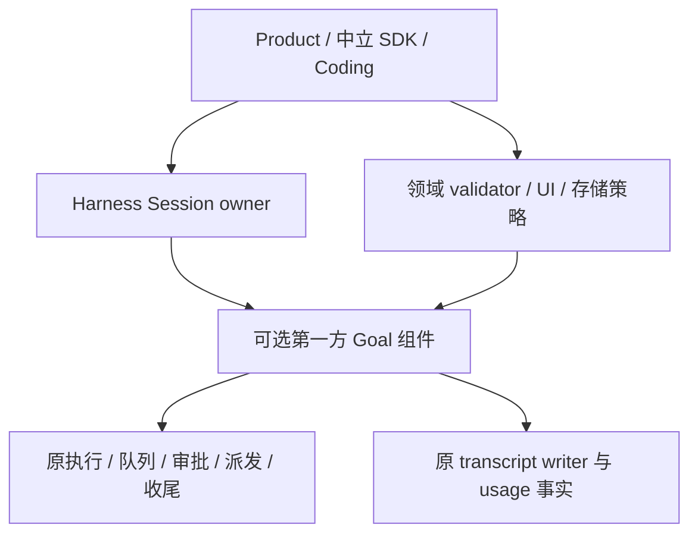

# Harness 可选 Goal 组件设计与实施方案

## 状态与交付边界

- Authority: proposed — implementation proposal, non-normative
- Design status: proposed
- Implementation status: not-implemented
- Owner: Harness Session / Goal component；跨界合同由 Loushang architecture 协调
- 日期：2026-10-17；方案版本：GC-R2（三视角初评后的固定复核输入）
- Current 基线：本地 `main` `df4324d1ddb9db2b3b6666a00b55240353934d9d`；未核验远端同步。
- 方法咨询：本地干净 archmethod `master` `0f9bd3ff51afabeaaf76cc38dff1ceb279b7d37e`；不改变项目已采用版本。

用户指定首版以 Harness 可选组件交付完整 Goal，插件化只由将来的独立交付需求驱动。本次只重新设计、独立评审和文档验证，不实施功能、不激活目标、不发布或新增 PR gate。以下新类型、接口、配置、版本和测试均为拟议；已具备的框架能力单独列为 Current。评审完成不等于功能实现或具体合同成为 accepted Target。

## 1. 目标、范围与方案比较

首版提供 create/view/edit/replace/pause/resume/clear、跨回合自动推进、持久恢复、预算、反空转、逐项完成审计，以及 CLI/TUI/SDK/hosted 一致控制。Coding 与无 Coding 的最小 Harness 应用使用同一 Goal 实现。Goal 不依赖独立 Package、插件安装或 Native Extension。

| 方案 | 选择与理由 |
| --- | --- |
| Coding 自管 Goal | 不选；通用状态、推进和审计属于 Harness，产品提供领域验收及界面 |
| 普通 Harness Extension 承载 Goal | 不选核心承载；生命周期观察不等于 whole-execution settled，钩子不能替代原子准入和唯一 writer |
| 首版完整可管理 Plugin | 延后；独立版本、安装、撤权和卸载不是本次首版驱动，避免新增声明/loader/Package 生命周期依赖 |
| Harness 内置可选 owner component | 本次选择；随 Loushang 发布，Session 精确拥有实例与生命周期，完整行为在组件，执行保障在原 owner |

这改变了 [GP-R2 插件提案](2026-10-16-goal-plugin-design.md)的首版交付选择；旧提案及其[评审](2026-10-16-goal-plugin-reviews.md)保留原字节作为历史设计输入，不沿用旧评审结论。更早的 [Coding R3](2026-10-15-goal-command-plan.md)同样不再作为当前方案入口。

保留：完整 GoalRuntime、执行准入与收尾、逐请求上下文、原日志唯一权威、精确 usage、完成 ticket、无 Coding 纵切。移出首版：Goal Wheel/manifest、`session_goal` Plugin contribution kind、新 Plugin IR/ABI、verified 单文件 loader、独立 Plugin Desired/Instance/GC、ImportRealm 双版本处理、禁止运行不可信插件代码的退役分流。后者的需求由“内置可信代码”消除，不用于削减执行权限撤销、停止与恢复保障。

长期无人值守、定时唤醒、多目标并行、团队共享、跨设备接管和运行中替换实现不在首版范围。普通会话内跨回合推进和完整恢复仍在范围内。首版可选 token 预算，无预算不隐式设限，所有目标仍有反空转与权限控制。

## 2. Current：已有能力与实际缺口

| 当前事实及证据 | 复用与新增边界 |
| --- | --- |
| [component_contracts.py](../../../src/loushang/harness/capabilities/component_contracts.py)支持 first_party/plugin 来源 | 复用 first_party；新增 Goal Definition/候选/owner policy，不伪造 Plugin locator |
| [component_binding.py](../../../src/loushang/harness/capabilities/component_binding.py)、[component_runtime.py](../../../src/loushang/harness/capabilities/component_runtime.py)提供 typed binding、generation、lease、dispose | 新增 Session Goal 组装和业务 drain；框架存在不代表 Goal 已可挂载 |
| [resource_catalog/components.py](../../../src/loushang/harness/resource_catalog/components.py)已有第一方组件组合模式 | 借鉴明确 owner admission→selection→binding，不依赖 Plugin artifact host 才能构造 |
| [session_contracts.py](../../../src/loushang/harness/capabilities/session_contracts.py)为 v4 sealed，含 max4/exact4 Consumers | 没有 Goal facet；新增可协商 v5 路线及 owner-reviewed Consumer 迁移 |
| [command_pack.py](../../../src/loushang/harness/session/command_pack.py)、[queue_controller.py](../../../src/loushang/harness/session/queue_controller.py)已有命令与队列 | 新增 Goal 命令、跨外内执行 owner 的原子 idle/epoch/settle 窄接口 |
| [execution_guard.py](../../../src/loushang/appservice/execution_guard.py)、[runtime/turn.py](../../../src/loushang/harness/runtime/turn.py)已有宿主/回合执行 | 复用原执行权；task.done/agent_end 不等于整个执行收尾 |
| [transcript/session.py](../../../src/loushang/harness/transcript/session.py)、[unit_of_work.py](../../../src/loushang/harness/transcript/unit_of_work.py)、[writer_lease.py](../../../src/loushang/harness/transcript/writer_lease.py) | 复用 ExtensionData 和原 writer；新增 Goal schema/reducer/幂等查询，不新建数据库 |
| [model_call.py](../../../src/loushang/harness/session/model_call.py)、[model_usage_types.py](../../../src/loushang/harness/transcript/model_usage_types.py) | 复用 committed Model Input/原始 attempt；新增归属、context contribution、预算派生投影和未知用量策略 |
| [Extension 边界](../architecture/harness/extension-runtime-core-boundary.md)、[Harness 原则](../architecture/harness/refactoring-principles.md)、[Plugin 架构](../architecture/harness/plugin/architecture.md) | 支持中立机制和可复用默认实现；组件归属与插件交付分别判断 |

Current 尚无产品 `/goal` 或完整 GoalRuntime。本文不声称新增端口、Goal slot、v5 或原子 ticket 已实现。无 Goal 的 v4 路线继续可用，既有 Plugin schema/发行流程不因本方案增加新 kind。

## 3. 首版要求与可观察结果

| ID | 要求 | 验收结果 |
| --- | --- | --- |
| G01 | 设置/查看/编辑/替换/暂停/继续/清除；一 Session 一当前 Goal | 所有入口同一 typed 服务；非法输入零模型请求；明确替换 |
| G02 | 原目标、状态、预算、进展跨压缩和重启持久 | 从原日志 replay；未启用组件仍可读历史和最后状态 |
| G03 | 用户工作优先，整个执行 settled 后续跑 | 原 owner 原子准入；无双启动、无丢输入和忙轮询 |
| G04 | pause/clear/interrupt/disable/close 阻止新派发并明确收尾 | final-admission 顺序确定，已发生效果可追查 |
| G05 | 原范围完整、完成逐项证据、阻塞可恢复 | 缺项/过期/收尾未知不 complete；模型判断明确标注 |
| G06 | 可选预算、主执行/retry/压缩/后代归属、幂等记账 | 缺用量不按零；有限预算未知消费停新请求 |
| G07 | 崩溃不重放未知动作；旧工作区/分支/导入导出兼容 | 操作查询/恢复提示；不要求重置工作区 |
| G08 | 显式用户执行授权，原 approval/sandbox 始终生效 | 启用不启动；目标/工具输出/扩展改写不能铸造权限 |
| G09 | TUI/CLI/SDK/hosted 状态与运行寿命一致 | receipt、stopping、settled、终局结果分别表达 |
| G10 | Work/Method 独立权威、产品中立 | 不依赖 Coding/Work/Method/UI/provider 实现；领域 validator 可注入 |
| G11 | 可选第一方组件，单 Session/generation 唯一实例 | 未启用零 Goal 执行/订阅；半发布不开放控制；刷新不重复创建 |
| G12 | 无 Coding 的完整实际组装纵切 | 中立应用创建→至少两轮→pause/resume→恢复→审计→complete |
| G13 | 随宿主升级/回退，保留旧 Session 与 Plugin 使用路线 | v4/v5 明确协商；unknown schema 停 Goal，普通历史可用 |

## 4. 结构、组装与可选性

### 4.1 责任分配与依赖



| Owner | 拥有 | 边界 |
| --- | --- | --- |
| Harness Session owner | Goal 契约、slot、组装、Consumer/lease、命令/context 发布、禁用和恢复协调 | 不承担第二份 Goal reducer；不替换整个 Session Provider |
| Harness Goal 组件 | 唯一 GoalRuntime：状态及唯一写入、共享纯 reducer、续跑策略、进展/阻塞、预算投影、模板、默认 assessment、完成审计与命令/工具 | 不另建 agent loop/run 队列、usage 事实、writer 或工具权限 |
| 原执行/持久 owner | 原子执行准入、派发/权限、取消/settle、Model Input、raw usage、固定记录提交 | 中立机制不包含 Coding Goal 语义或领域完成判定 |
| Product | 是否装配、配置/控制身份、CLI/TUI/hosted、存储根/保留、领域 validator、Work adapter | 不复制 GoalRuntime，不默认扩大执行权限 |

候选物理位置为 `loushang.harness.session.goal`，按 contracts/runtime/reducer/continuation/accounting/audit/context/components 分模块；这些是实现划分，不新增顶级 subsystem/Capability graph 节点。组件是 `harness.session` 内 `goal.runtime` slot；请求该 slot 时 exclusive/exactly_one/min=max=1，不请求时从本次 selection 的 Definition 集合中排除该 slot，而非保留 Definition 仅传空候选；不能将当前 exclusive 规则改成 min0。

Goal 不 import Coding、AppService、HarnessTUI、Work、Method 或 provider 实现；使用原 Agent/AI 的中立事实适配端口，不反向接管它们。WorkRun 是一次执行承诺，Goal 是结果契约，可关联 opaque run/evidence refs；Work success 只作证据。Method enactment 继续经过原 Product/HarnessWork 权威，Goal 不复制正式计划或修改 Work 终态。

### 4.2 第一方绑定与版本

Product 显式传拟议 `GoalOptions(enabled=False, ...)`，缺省未启用。Session owner 先选择 v4/v5 composition，验证持久 Session、execution/storage/context ports 与用户通道策略。启用时注册 Goal Definition，通过原 owner authority/admission/selection 得到唯一 first_party 候选，再建立 `CapabilityOwnerComponentBinding(create, validate_payload, dispose)`，使用原 component runtime 发布/lease。无需经过只面向 artifact 的 `CapabilityOwnerComponentHost`。factory 仅暂存注册、replay 和构造，不能发模型或业务效果。

binding spec 用 `source_kind=first_party`，实现来源、实现修订和内容/配置指纹由宿主发布构建元数据及 owner 提供；不使用 plugin_id、factory_path 等 Plugin 字段，不把身份指纹当恶意代码隔离或安装授权。首版只接受随宿主可信发布的唯一内置实现，不加载用户任意 Python 工厂。构建修订随宿主版本固定，不引入独立依赖求解或热替换。

候选 `harness.session` v5 增加 `interaction.goal`，typed `GoalConsumer` 持有 generation lease，所有 mutation/推进方法重新检查 live/execution authority，只读方法按 §6.2 的独立读取合同工作；不存在可泄漏的裸 runtime 服务。一个 graph 只用一个 Session bundle 版本。未启用沿旧 v4 composition；启用要求支持 v5 的 Provider/Consumer。新 v5 为所有已有 facets 提供原行为，并提供可选 Goal handle；未选 Goal 时不得假造 enabled。旧 max4/exact4 不能自动消费 v5，C0 成套核对实际 Requirements、typed equality、Provider metadata、Coding 默认插件的硬编码 requirement 和测试；允许升级范围前须取得原 facets 兼容证据。未知/第三方 v4-only 贡献与 Goal 同组装时显式 unsupported，可继续原 v4 无 Goal 路线，不能静默丢弃插件或强行扩大旧范围。Plugin IR/manifest 和旧 golden 不改；已有插件自己的 Session requirement 迁移属于兼容工作，不等于新增 Goal 插件。

Session usability barrier 在组件、命令/工具 Catalog、context 和 Consumer 都发布成功后才开放 Goal；各 owner 保留自己的 receipt，不虚构跨 owner 事务。失败先封 Goal 资格，撤销部分注册并保留 cleanup debt。显式启用但失败返回诊断；可按显式用户选择重开无 Goal 路线，不能悄悄吞掉选择。内容刷新仅更新投影，不再构造 runtime。

**Goal 命令独立发布。** 由 Session Goal owner 的独立 descriptor/executor contribution 发布 Goal commands/tools，不把它们直接加入既有 `coding.base` 标准 command_pack，不更改其固定 admitted command identities。当前 coding.base 命令包没有 Session requirement，不以它证明 exact4 消费；实际 v4/v5 Consumer 以源码盘点为准。未启用时宿主可提供 §6.2 的纯只读 view/用法提示，但不注册模型 mutation 工具或可执行 Goal command pack。

### 4.3 窄接口与逐请求上下文

复用原 owner 并注入权限分组，不建立八套服务/registry：`GoalRecordPort`（本 Session namespace 追加/CAS/精确 lookup）、`GoalExecutionPort`（start_if_idle/cancel/settle/observe_admission）、`GoalDispatchPort`（opaque fence/ticket）、`GoalUsagePort`（只读精确 attempt/outcome）、`GoalInputPort`（原始 GoalIntent/epochs）、`GoalContextPort`（lease 约束的贡献）、`GoalEvidencePort`（引用/validator）、`GoalPresentationPort`（中立 receipt）。接口名拟议；实际调用链和 owner 在 C0 用源码 spike 校准。构造期 ports staged，不可发起业务执行；无自身 Graph edge 或向 model_input 上层节点的循环依赖。

组件产出 `GoalContextContribution(template/version, objective/requirements/budget/progress refs, content, binding_digest)`。原 Session/request-context owner 选择、排序、组合和撤销贡献，在每次 convert_to_llm/prepare_model_call 前冻结内容，使真实 transport 与 committed Model Input 同源。输入含 execution_origin、goal attribution、purpose、control/snapshot revision、input/navigation epoch、source refs、lease；owner 在 commit 和最终 dispatch 复核，stale 丢弃准备结果。

Goal-bound 用户 turn、自动 turn、同轮 sampling 和 retry 都带目标；compaction 只带 data-only 保留约束，重建后重新投影；独立 side_question 明确无 Goal 指令/mutation/accounting，即使继承 callbacks 也按 purpose 排除。模板由内置组件版本化维护，不只在自动继续 prompt 上注入；只返回 CallOptions 的 preparer 不能冒充上下文 producer。停用/lease 失效使旧 contribution 即刻不可用于新请求。

### 4.4 启用、停用与组件寿命

配置启用只选择功能。构造/replay/重连/刷新均不启动 Goal；只有受信 create/resume intent 授予实际推进。首版不在 live sealed Session 上增挂或替换组件：false→true 后重开/重新绑定 Session，旧 writer 释放后装配，历史恢复按 §7 明确 resume。

true→false 对当前拥有该组件的 Session 先同步封 continuation/final dispatch 与 context/control 使用资格，再由原 operation owner 请求 pause、cancel/settle、撤销注册并保留 drain receipt；limited/blocked 原停因保留，不能改为 complete。关闭配置同时作用于下次 composition。已 sealed 对象可保留不可用 handle 直到 Session close，不能靠普通 refresh 热挂新实例。禁用失败/结果未知保持封闭并保留 debt，不报告成功停妥；其他独立普通会话执行不因此被取消。之后重新启用须重新打开 Session、reconcile 并由用户 resume，不自动延续。

执行权限/Session authority 撤销先由原宿主同步关闭所有 Goal permits；内置可信 cleanup 仍可运行，执行授权撤销不等于禁止调用程序自身的清理代码。若组件抛错/无响应，宿主负责已登记 execution、许可和订阅的收尾，保存 owner suspension/debt；无法证明释放则不签发 disposed/settled。此次不引入插件“不再运行被撤权代码”的隔离协议。

同一 invocation 发起 pause/disable/close 只返回 pending，请求栈退出后由 owner drain，禁止等待自身 settle/disposer。持久写 unknown 时沿原 operation/digest 查询，不能为写 pause 构造第二个 reducer。Session close 先封许可和收尾，再释放 Consumer/组件 lease、按原 runtime dispose，失败由原 owner 保留可查询债务。没有 Goal 时不注册 Goal 唤醒/模型工具或写 Goal 记录；通用 idle/dispatch 基础检查仍服务其他原执行。

### 4.5 首版选择入口与操作例子

首版选择为**启动/构造级显式选项**，不新增全局/项目持久 Goal 开关，也不复用 Capability mount 配置。Coding CLI 拟新增互斥的 `--enable-goal` / `--disable-goal`，缺省 disabled；选择只作用于本次执行宿主/目标 Session。项目文件、Skill、历史 Goal 记录和普通 prompt 不能隐式启用。普通 TUI/CLI 都由同一启动参数传入 GoalOptions；首版无交互设置编辑 UI。

`--goal-command` 只提交命令，不隐式启用。未启用时 view 可走纯只读查询；create/edit/replace/pause/resume/clear 等 mutation 返回 goal_unavailable/CLI exit 2，并提示以 `--enable-goal` 重新打开。用户要立即停止已启用目标可用 `/goal pause`，不必关闭功能。SDK 由受信构造者传 `GoalOptions(enabled=True)`；hosted 仅受信 server-side Session constructor 决定启用，客户端 GoalCommand/协商声明只能请求已提供能力，不能改变服务端 composition。

原 Session owner 提供拟议 typed `disable_goal(operation_id)` 给受信宿主控制者（首版不新增 slash 配置命令）。它将该宿主对该 Session 的后续构造选择设 false，并按 §4.4 fence/drain；返回分别标记 `selected_enabled=false, selection_status=applied`、drain=pending/settled/failed 与 operation ID，不把启动级选择宣称为磁盘配置已保存。宿主重启时仍默认 false，除非构造者再次明确传 true；同一 sealed binding 不能重新启用，须关闭旧绑定并重开。若没有 live host control 通道，则 pause 后退出，再不带 enable flag 重开即为禁用；不承诺外部 CLI 能修改另一进程的启动选项。hosted 控制者身份来自原 server owner policy，普通 attachment 不能自授 disable/config 权。

可执行入口的拟议顺序：缺省运行无 Goal → `loushang --enable-goal --goal-command '/goal set -- 完成目标'` 新建并持有宿主至停止 → `loushang --resume <id>` 不启用，仅显示 unavailable 历史 → `loushang --enable-goal --resume <id> --goal-command '/goal resume'` 显式恢复。SDK live disable 取得 settled 后关闭/重开，默认仍关闭；重新传 enabled=True 只装配，仍需用户 resume。恢复原 paused/limited/blocked 及 debt 条件全部适用，不因重新启用而重置预算。V10/V14/V15 验证上述传递、默认值、拒绝/只读、server/client 权限和自停收尾。

## 5. 状态、权限和命令合同

拟议公开状态：`active / paused / blocked / usage_limited / budget_limited / complete`；没有 Goal 用空 snapshot 表达。`complete` 对该 goal_id 不可逆；重新开始创建新 ID。`budget_limited` 可在用户增加预算后恢复；与 complete 的含义不同。`blocked` 同时承载业务阻塞和带 reason_code 的运行时熔断，不表示任务完成。

| 操作 / 起点 | 结果 | 授权与副作用 |
| --- | --- | --- |
| create：无 Goal 或 complete | active，新 goal_id | 仅显式用户命令或本回合可核验的明确请求 |
| view：任意 | 不变 | 不发模型请求 |
| edit：未完成 | paused，revision + 1，保留 goal_id / 既有用量 | 用户显式提交；旧 invocation 全部 settle 后才能 resume；重置进展/阻塞计数；验收条件变化有历史 |
| replace：未完成 | 新 active、新 ID、旧目标 archived | 仅用户显式 replace；一个原子记录，不先 clear 后 create；旧执行先 fenced 并 settle |
| pause：active | paused | 用户控制；撤销待续跑；取消当前全部 Goal-bound 执行并完成收尾；独立用户执行遵守下面的归属表 |
| resume：paused / blocked / usage_limited | active | 用户显式请求；权限和运行时可用性复核；阻塞计数清零 |
| resume：budget_limited | active 或拒绝 | 仅用户提高预算或显式取消上限后，且已用量小于新上限 |
| clear：任意 | 当前 Goal 为空，追加 tombstone | 用户控制；fence / settle 同 pause；审计历史仍保留 |
| request_complete：active | active + completion_pending 投影 | 工具只保存完成候选并返回，不等待自己 settle；唯一服务在 §9 条件满足后 CAS 提交 complete |
| 系统熔断：active | blocked / usage_limited / budget_limited | 原因和事实由代码记录；不得假装完成 |

执行来源、费用归属、执行许可分别保存，不能靠去掉 attribution 绕过预算：

| execution 类型 | pause / clear / edit / replace | budget/usage limit | 迟到费用与状态 |
| --- | --- | --- | --- |
| 自动续跑或明确推进 Goal 的用户执行（Goal-bound） | 统一撤销新 dispatch 许可并取消/settle 当前执行及所属后代，不因来源是用户而豁免 | 同样受 Goal 预算与熔断控制 | 仍归原 goal_id；不能 mutation 新目标 |
| 显式独立 side question / 无 Goal attribution 的普通用户执行 | 不取消；但当前 Goal 的 mutation 和自动续跑不能混入该执行 | 不消费 Goal 预算；仍受全局 provider/权限限制 | 单独记原有 usage，不转移已有 Goal 费用 |

当前 Goal active 时，普通推进任务的 prompt 默认 Goal-bound；独立 side-question 必须走明确的现有 side-question 路由，不能由模型事后把昂贵步骤改称独立任务。paused/无 Goal 后新普通 prompt 可以独立执行，但不恢复目标、不能为其提交完成。控制表指全部 Goal-bound 执行，并非取消 Session 中每一个用户操作。

默认归属使用 effective Goal authority，不直接读 persisted status：只有 active 且组件已挂载、lease/current intent 可用、无 recovery/quarantine/retirement 阻塞时，普通推进 prompt 才默认 Goal-bound。raw active + unavailable 时普通 prompt 仍可作为独立会话执行，宿主在提交前显示/输出“Goal 不可用，本请求不推进该目标”，receipt 明示 attribution=none；不得使用不可用组件的 context、validator 或费用转移。显式 Goal resume/推进控件返回 goal_unavailable，不降级成普通 prompt；独立 side-question 继续独立。该规则由 §6.2 同一纯只读投影与宿主 live guard 实现，不调用不可用 GoalRuntime；新独立执行不能 mutation/complete 旧 Goal，已发旧调用仍归原账。V17 包含真实普通 prompt、显式推进拒绝与重新启用后的恢复归属。

暂停/清除的“停止未来自动启动”在控制记录提交时生效；“收尾完成”在 execution settle 后生效。同步客户端等待收尾；异步客户端收到 stopping 投影和操作 ID，最终 settled receipt 才表示收尾成功。`stopping` 是控制操作投影，不新增 Goal 公开状态。外部动作已成功时如实记录，取消不承诺回滚。清除后迟到 usage 仍归旧 goal_id 的归档账，不写进新 Goal。

命令统一经 typed session command dispatch：

```text
/goal                              查看；无目标时显示用法
/goal <objective>                  创建；未完成时提示明确使用 replace
/goal set [--token-budget N] -- <objective>
/goal edit -- <objective>          编辑后暂停，保留历史用量
/goal replace [--token-budget N] -- <objective>
/goal pause
/goal resume [--token-budget N | --unlimited]
/goal clear
```

保留字作为目标可用 `set -- pause`。预算只接受正整数，拒绝 bool/零/负数/溢出；不接受模型自行推定预算。空目标、超限目标（首版建议 UTF-8 64 KiB，可配置）和非法选项在任何状态写入或模型请求前报错。`edit` 后保留原预算，不能绕过累计用量；complete 只能新建。ephemeral/read-only Session 返回不支持持久 Goal，可继续普通 prompt。首版不隐式读取目标文本里的路径或 `@file`；文件上下文仍走原有用户输入路径。

模型工具拟议：`get_goal()`、`create_goal(objective, token_budget?)`、`update_goal(status, expected_goal_id, expected_revision, audit?)`，另有 `report_goal_progress(expected_goal_id, expected_revision, progress)` 提交回合证据。update 的 complete 是提交候选，不是立即终态。create/paused 必须匹配宿主独立 GoalIntent，update 只允许 complete/blocked/paused。模型不能 resume、改预算、clear、replace 或写任意 Session。工具身份从绑定读取，参数不能指定其他 Session。工具可见性不是权限校验，handler 再校验身份、generation 和权限。

### 5.1 首版入口与 headless 运行寿命

以下为拟议语法，尚未实现。嵌入式 TUI 使用上述 slash command；单次 CLI 增加 `--goal-command` 和 `--goal-output text|json`，与 positional prompts 互斥，例如 `loushang --enable-goal --resume <id> --goal-command '/goal resume' --goal-output json`。无 `--resume` 的 create 使用既有新 Session 流程；不支持 ephemeral。解析后直接调用相同 typed service，不把 slash 文本再发给模型。Goal 组件经 Session owner 的现有 descriptor/executor 组合贡献通用命令；Coding 只选择该贡献与适配 CLI。Goal 控制 API 同时供中立应用使用。

- 本地单次 CLI 的 create/replace/resume 默认持有 Session writer 和事件订阅，直到 Goal complete、paused、blocked、budget_limited、usage_limited 或被 clear；不能第一轮返回就沿旧 plain_prompt_host 的固定 prompts finally dispose。view/edit/pause/clear 等控制操作在其所需 receipt/settle 返回后退出。
- 此 CLI 首版无 detach/no-wait 运行模式；不启动隐式后台服务。Ctrl-C 先 fence 再 abort/settle，最终输出状态并退出；强杀后按恢复规则处理。非交互 approval/question 没有可用回答通道时，立即停止为 blocked(interactive_input_required)，不能循环等待三轮或假设批准。
- 嵌入式 SDK 的 GoalCommand 返回 receipt，Goal lifetime 由当前 Session owner 保持。hosted 长连接使用拟议 capability-negotiated GoalCommand/Get/Subscribe 数据协议；服务端控制身份从现有 binding/scoped attachment 取，执行仍走原 hosted owner。未协商的客户端返回 unsupported，不能降级成普通 prompt；连接 detach 与宿主 close 分开。
- 结构输出区分 `command_receipt` 与 `goal_result`。本地运行到 complete 退出 0，paused/cleared 退出 3，blocked 退出 4，budget_limited 退出 5，usage_limited 退出 6；参数/unsupported 退出 2，运行/存储失败退出 1，Ctrl-C 成功收尾退出 130。view/明确 pause/clear 的控制命令成功为 0，不把“控制成功”解释为任务完成。cleanup debt 显式返回失败及 operation ID，保留恢复记录，不能输出成功收尾。

### 5.2 最小数据与权限协议

C1 定义 typed `GoalCommandRequest(operation_id, expected_goal_id?, expected_revision?, kind, payload)`；Session/actor/generation 从可信 binding 取。`GoalReceipt` 包含 operation_id、goal_id、control_revision、record_id、disposition（committed / already_committed / pending_settlement / rejected）、snapshot_revision、reason_code 和 execution_refs。模型控制 handler（含 paused/blocked）不得等待自己所在 execution 收尾，只返回 pending receipt，由原 owner 结束执行并发最终事件；外部同步客户端才可等待最终 receipt。失败码至少为 invalid_input、conflict、unsupported、unauthorized、storage_unknown、settlement_pending；同幂等键不同 payload 是 conflict。无目标 clear、重复 pause 返回幂等 receipt，complete 的 resume 明确拒绝。

GoalIntent 是拟新增的宿主中立输入权限凭证，含可信 actor/channel、原始 request ID、Session generation、允许的 mutation、objective/预算摘要及撤销/消费状态。它由 typed 用户命令、SDK 显式 Goal 操作或受信输入适配器识别的原始用户明确请求产生；原始输入须在 extension transform 前锚定。自然语言歧义时只生成 draft，不启动 Goal，等待明确 Goal 操作。模型只能消费已绑定 intent，不能自填授权证据。Resource/Skill request_evidence 只用于来源追溯，不是该凭证；application message、工具结果、历史对话和扩展改写不能铸造 GoalIntent。当前没有 intent adapter 时隐藏模型 create/paused 工具能力，CLI/TUI typed 命令仍可用。

完成审计还绑定不可变 `assessed_input_watermark` 和实际 `model_input_snapshot_id`：水位由原输入/Model Input owner 在冻结此次实际已消费上下文时生成，并随 audit/candidate 原样携带；模型/工具 handler 不能填入或补读最新 input epoch。原 owner 维护 admitted 与 consumed/assessed 的关联，最终 ticket 要求相关输入无 admitting/pending 未覆盖项，且当前相关 input watermark 与审计水位一致。completion 工具的 graceful end 在队列轮询前返回也不能跳过该检查；在模型输入 E 后、候选前入队的 E+1 steering/follow-up/mailbox/application 输入会使旧候选拒绝，保留并优先处理该输入后重新审计。显式独立 side-question 的排除由宿主 purpose 分类决定，不能由模型事后改归属。普通只读 Goal view 不升级审计水位。

初次 goal record 保存 `RequirementSet(revision, objective_digest, items[id, original_anchor, acceptance, constraints])`；原文锚点必须覆盖完整目标，拆解只是模型提议，宿主不能据删减列表宣称完成。后续建议作为新 analysis record，不能删原要求；改变用户目标仅经 edit。`GoalProgress(execution_id, classification, evidence_refs, next_action?, blocker_fingerprint?, wait_ref?)` 在每轮 settle 前提交候选，之后关联最终执行事实；`GoalAudit` 的结构见 §9。repeat/stale 提交用 operation_id/expected control revision 校验。control_revision 只随用户控制/目标语义/终态变化；usage/progress 只推进 snapshot_revision，避免记账不断使控制候选无故 stale。

## 6. 持久数据、分支与版本

复用现有 transcript UoW / writer lease，通过 Harness-owned `ExtensionData` 命名空间存 Goal 事件。拟议 `harness.goal.v1` envelope 包含：`schema_version, operation_id, session_id, goal_id, revision, event_kind, expected_revision, payload, actor_ref, source_request_ref, implementation_revision_ref, component_generation, timestamp`。单条提交构成控制变化的原子边界，成功 receipt 后才发布 UI 事件。重试按 operation_id 幂等；同 ID 不同 payload 拒绝。

reducer 产生 `GoalSnapshot`：目标全文、约束/验收条目、状态/停因、预算/known_tokens/budget_usage_quality、累计 active elapsed、最近进展与阻塞 streak、control/snapshot 两种 revision、待收尾 execution_refs、continuation claim 和审计引用。时间用进程内 monotonic delta 持久化；离线时间不算执行耗时，不宣称精确成本或账单。

- Goal 属于 Session，按所有已提交控制记录的顺序 replay，不按 active conversation path 重建；切换历史 branch 不撤销已提交 pause/clear/budget。目标验收标注所选历史 lineage、显式 navigation_epoch 和 source_cursor 证据锚点。navigation_epoch 只在用户显式历史导航/branch selection 时变化，正常 append 不改变它；source_cursor/leaf_id 随追加推进不等于导航。显式导航变化使未终结目标的完成候选失效：active 变 paused；paused/blocked/usage_limited/budget_limited 保留原停因并要求重新审计，budget 限制不能被换分支解除。已 complete 保持不可逆终态及原 branch/cursor 的历史审计，UI 标注其适用范围，不将历史完成结论推广到当前分支；要重验应新建 goal_id。
- 新 Session 不继承 Goal；fork/clone/import 默认不继承 Goal 执行权威，具体转换见下面矩阵。旧 Session 保持自身状态。
- 压缩只重写模型上下文投影，不能丢控制记录/用量；每次模型输入都由当前 snapshot 重新注入目标引用和版本，并进入既有 committed Model Input。
- 目标设置、清除、replace 在一个现有 writer lease 下顺序提交；多个客户端使用 CAS revision。派生 snapshot/cache 可重建，不维护第二份 authoritative JSON/SQLite。
- 未知 schema 不执行目标，给出可恢复诊断；不破坏普通会话读取。旧工作区无命名空间时自然解释为空。回退版本保留原始 ExtensionData，关闭 Goal 自动执行；实施阶段必须用实际旧版本验证其可读与往返保留，不能仅凭“扩展字段应被忽略”作承诺。
- 不修改机器消费的 Session header。event/schema 若触及既有兼容契约，实施时先提交对应共同父级 ARD；本方案不以改 header 为前提。

### 6.1 分支、fork 与导入导出转换矩阵

共享 transcript 的现有 export/fork 可能只复制所选 branch；Goal 不能假定它们会带全 Session 控制记录。本方案选定：**副本默认不继承 Goal；历史 namespace 不直接成为新执行权威**。

| 操作 | active / 其他未终结 | complete | cleared / 无 Goal | unknown schema |
| --- | --- | --- | --- | --- |
| 同 Session branch switch | 按上面的状态规则停止自动推进、废弃候选；不按旧 branch 恢复状态 | 保持 complete 和历史审计 | 仍无 Goal；旧 create 不复活 | 停止 Goal，普通历史可读 |
| fork/clone 到新 Session | 默认无 Goal；显式 copy-goal 才从源 Session 当前全序 snapshot 生成新 paused Goal、新 ID、零新账和 provenance | 默认无 Goal；显式 copy-goal 创建 paused 新 ID，旧完成只作参考 | 无 Goal，即使所选 branch 有旧 create | 禁止 copy-goal，只保留历史诊断 |
| JSONL / bundle 导出 | 使用现有分支导出，但 Session export adapter 从导出记录剥离 Goal control namespace，保留其他记录，给出 Goal 未导出提示 | 同左；审计不被冒充当前控制状态 | 同左，避免遗漏 tombstone 后复活 create | 对 Goal namespace 做 opaque 剥离，不猜内容；提示无法迁移 |
| JSONL / bundle 导入 | 保持现有通用 header/session 身份语义，不声称 import 天然新建 Session；所有历史 Goal namespace 均隔离为非权威，只能经受准入的 Goal 组件显式重新设置 Goal | 历史完成可读但不授予当前 Goal 控制 | 当前无 Goal | 目标不执行，普通会话照常导入 |

Session 生命周期 adapter 在 writer/runtime publication 前完成导入/fork 的 namespace 处理，不能等 GoalRuntime 第一次启动时才 append 一条覆盖记录；失败则不发布新副本。现有目标 Session 的 writer conflict 按原机制拒绝，不能 import 合并覆盖当前 Goal。文件级备份恢复同一个原始 Session 的完整 authority 是另一条显式恢复路径，仍按 §7 先暂停；不能与普通 branch export/import 混用。

显式 copy-goal 若有 evidence ref 不在副本中，只保留 opaque provenance，不当成 proved；首版不复制 audit candidate、执行 claim 或旧费用。fork 到目标创建前的 leaf 也只可在显式 copy-goal 时复制源 Session 当前 snapshot，必须在 receipt 明示 source goal/cursor 和新目标 paused，不由历史 leaf 猜目标。旧版本产生的分支副本在新版本导入时也执行隔离策略。V02/V12 必须覆盖 clear 在非所选路径、fork 到 create 前、两种导出格式、旧版往返和 unknown schema。C0 要验证当前 export/import adapter 的真实 hook，以上外部选择已固定，不能以 spike 留白替代。

### 6.2 未装配组件时的唯一只读投影

本次选择**复用同一份纯 replay/projection**，不新增持久 snapshot/read-envelope、数据库或宿主第二 reducer。Harness Goal schema/model 模块拥有唯一无副作用 reducer；live GoalRuntime 和宿主 `read_goal_view` 都调用这份实现。可选的是有行为的组件实例及其 mutation/续跑权限，内置 schema 解析函数可在 disabled 时加载。纯投影不构造 GoalRuntime，不注册事件/工具/context，不写日志、发模型或授予执行权；active runtime 唯一提出并提交 Goal 状态变化，read path 只重放已提交事实，不能推断/写入恢复 pause 或 complete。

原 transcript owner 按 Session 已提交全序提供 Goal records，跨全部 branch，投影到明确 `projected_through_record_id`；用量由原 usage owner 在同一 committed 截点提供 immutable exact-attempt 数据视图，一并作为纯投影输入。迟到补充已落原账而 GoalRuntime 尚未运行时，只读 view 仍可更新已知用量/质量，不据此推断或写入 limited/complete；相关 source cursor 与 usage fact version 随输出保留。输出 data-only `GoalReadView(projection_version, projected_through_record_id, schema_status, current_goal_or_none, implementation_revision_ref, record_refs, known_goal_debt)`；supported schema 精确得到同一 GoalSnapshot（目标全文/状态/停因/用量/clear tombstone 等）。owner 自己的 suspension/cleanup journal 以独立 overlay 附带 freshness/known-debt 下限，不从组件异常猜测业务状态。缓存只按确切 committed cursor 加速，丢弃后同函数全量重放；查不到 cursor 或原写结果 unknown 时标为 read_unknown，不发布貌似最新状态。

schema unknown、记录损坏或 provenance 未通过时，投影返回 unsupported/corrupt/unverified 与最早不支持记录/已知 source refs，不跳过后继续拼成当前状态，也不沿更早 create 宣称 active/complete；最多显示明确标注的旧已知诊断。未知 payload 不保证能读取目标正文/业务状态。宿主的 effective authority 另看组件选择、live guard、intent 和 recovery/debt；只读 active 永远不授予执行权。普通 prompt 分类只能用该 data view 和宿主 guard，不调用不可用 runtime。

**日志来源与 namespace 准入。** Current 的 ExtensionData 只是 JSON 容器，不自带 Goal owner 权限。首版须在原 transcript/session append 入口为 `harness.goal.v1`（以及 §8 的 usage 补充 namespace）建立 reserved-owner gate：只有原 owner 铸造并绑定 Session/writer generation 的内部 port 可提交，普通 Extension append/session-entry/tool 路线即使提供同名字串或复制 payload 也被拒绝。原 writer 记录 admitted operation/source 与 commit receipt 的关联；Goal replay 只接收经原 owner 路线提交、校验关联的记录，不把 payload 自填 actor/receipt 当授权。旧文件预存同名未验证数据、普通 import/fork 按 §6.1 隔离，不能凭命名成为权威。信任前提仍为原 Session 文件/宿主代码可信；不宣称可隔离已任意执行的同进程恶意 Python 或本地文件篡改。C0 固定 stamp/receipt 的具体存储和既有导入路径，不能另立第二日志。

只读 walkthrough：无缓存 + disabled 重启，纯投影还原最后状态并叠加 disabled；factory 失败仍可用同一纯函数，叠加 mount_failed；最后记录为 progress/usage 仍按全序还原；clear 在非 active branch 也得空目标；replace 得新 ID、旧费用仍属旧账；未知 schema/投影损坏返回 unknown 而非猜目标。V02/V16/V17 运行真实无缓存/构造失败/跨分支路径，V01/V12 验证 namespace 伪造及隔离。只读 envelope 指这里的 data-only 输出，不是另一种权威持久记录。

## 7. 原子续跑、取消与崩溃恢复

缺失的基础合同拟由 Harness Session 补充，名称暂定 `start_if_idle(request, expected_session_generation, expected_input_epoch)`、`on_execution_settled` 和单调 `admission_epoch` 变更通知。只暴露执行来源、队列/维护/收尾状态和准入结果，不含 Goal 类型。C0 必须区分外层 `CodingHostedExecution` 的 `ExecutionGuardV1` 与内层 Harness `HostRuntime`：hosted 自动目标执行必须先经同一外层 guard，不能直接 prompt 绕过它；外层到内层以 Product adapter/中立条件组合，Harness 不反向依赖 AppService/Coding。嵌入式与 CLI 同样只保留各自既有 execution owner。C0 给出所有入口到最终 settle 的实际调用链和唯一准入 owner，再决定窄 API 的物理位置。该接口由现有 execution/queue owner 实现；GoalRuntime 只有策略、claim 和事件订阅，不拥有第二条 run 队列。

必须共同检查：无活跃 invocation、全部用户/应用/steering/follow-up/next-turn/mailbox 队列为空、无 admission 中的用户操作、无 retry/compaction/recovery、无 approval/pending questions、无 cleanup debt、Session generation 仍有效、宿主不是 plan-only / disposing / switching。队列与宿主准入共享线性化点。`agent_end`、`turn_end` 和单个 Task.done 均不足以触发续跑。

续跑流程：

1. settled / queue-drained / explicit resume / admission_epoch 变化唤醒一次评估；先处理用户工作，再查 Goal active、预算和停因。
2. GoalRuntime 在自身短控制锁中取得 control revision 并提交 continuation claim（含目标版本、输入 epoch、上次 execution_id）。单一 writer 下每个目标版本最多一个未解决 claim。
3. 调用宿主 start_if_idle；原子取得执行所有权后，在发模型请求前复查 Goal fence、状态、generation 和 epoch，并提交实际 execution_id/Model Input 关联。任何不匹配取消 claim，不发请求。
4. Busy/stale 只记录原因并等待下一个真实状态变化，不轮询重试。Started 将 receipt 投影给 UI；本轮结束且 settle 后，持久化 usage/progress，再评估下一轮。
5. 用户在准入前到达则拒绝自动执行；准入后到达则走现有 steer/follow-up，按其原策略处理。pause/clear 的 fence 在每次模型/工具的最终 admission 校验；准确的在途定义见下面 dispatch 合同。

continuation claim 显式状态：claimed → started → settled；确定 Busy/stale/not_submitted 则 claimed → released，receipt 持久化后才允许同 control version 新建 claim（新 operation_id、最新 epoch）。started 必须关联实际 execution_id，重复通知只重放同 receipt，不再调用 start。start_if_idle acknowledgement 丢失/异常不能推断未启动：claim 保持 admission_unknown，封新 Goal 续跑，通过 GoalExecutionPort.observe_admission(operation_id) 查询原宿主的确切 started/not_submitted/unknown，不能以超时或缺消息自动重试。只有权威 not_submitted 才 release；started 则观察同一 execution；unknown/debt 等待原 owner reconciliation。崩溃留 unresolved claim 走 recovery_required，不能第二次启动。V03 覆盖 claim 后 consumed input 插入→确定Busy→release→epoch exit→恰好一次新准入；unknown receipt→查询而非重启。该查询为 C0 必须新增/证实的原宿主窄协议，不由 GoalRuntime 维护第二套 execution ledger。

Busy/stale 后不能漏唤醒：通用 owner 为输入 admission/interceptor/preflight/command、维护、approval/question 和 cleanup 的所有进入/退出推进 epoch；被消费的命令、验证失败、未启动 execution 的输入、维护拒绝也必须发退出通知。订阅后读取 epoch，评估完成再比较 epoch；变化则合并一次重新评估，消除 lost wakeup，不做定时空轮询。C0 列每个阻塞条件的进入、退出与通知 owner，V03 验证无 execution 的退出路径。

### 7.1 每次外部派发的最终许可

`start_if_idle` 只准入一轮，不能替代同轮工具/模型的许可。拟议中立 dispatch ticket 由原 tool/model execution owner 管理，绑定 execution、Session generation、opaque fence、action/attempt ID。Goal 控制先同步撤销本地许可，再经原 operation owner 顺序持久提交控制记录；提交未知时保持本地关闭，查询原 operation_id 决议，不回滚开放。

最终许可必须在 approval、policy audit、Model Input commit、retry 等 await **之后**、实际 handler/transport admission **之前**核验，不能复用进入审批前的许可。检查 fence 与登记 action 为 in-flight 在同一短同步临界区完成，不能在两者之间 yield。再交给现有 executor/adapter；approval 仍由原授权链决定。通用接口只接受取消/opaque ticket，不接收 Coding Goal 类型。

线性化点是 final admission，不是网络/文件系统真正完成的时间。已在该点登记的动作即为在途，可能在 pause 提交后才产生或返回外部效果；必须记录 ID、取消并等待 settle。fence 后不能再取得新许可。收到 late allow、await commit 后才抵达 final admission 的旧动作必须被拒绝。stopping receipt 说明仍在途的动作，settled receipt 才说明已无在途责任，不承诺撤销已执行副作用。V04/V07 在 late approval、commit-in-progress、预算与后代 dispatch 竞争点注入交错并核对许可顺序。

锁序：Goal 控制锁保护持久变更和短 snapshot 操作；宿主准入锁只保护队列/执行权。不能持有任一锁等待模型、工具或 settle。跨两者用版本/fence 复核，禁止 control → await execution → control 的等待环。设置和工具 mutation 不在锁内递归发 prompt。

Esc/interrupt 暂停 Goal 并撤销 claim，再调用现有 abort/settle；预算、权限耗尽不被 Esc 改成普通 pause。切换、退出、组件停用先阻止新启动，再收尾，最后 release registrations。TUI detach 不销毁仍被宿主持有的 Session，重连只读当前状态；如果执行宿主退出则走下面恢复规则。

恢复：进程重启不扫描所有 Session 启动 Goal。显式恢复 Session 时 replay；残留 claim、active execution 或未证明的 cleanup debt 叠加 recovery_required：此前 active 才转 paused，budget_limited/usage_limited/blocked 保留主状态，complete 保留历史终态，展示在途记录，用户 resume 前必须 reconciliation。禁止重放“可能已发生”的工具动作。清洁 shutdown 已保存 active 的目标也先显示恢复提示，由用户 resume 激活；这是比参考行为更保守的产品选择，保留跨回合自动推进。重启导致无法确认的外部效果由 Product adapter 查询实际状态；无法确认则 blocked，保留证据。

## 8. 用量、预算与反空转

Goal 激活时记录执行基线；仅将此后被准入且绑定 goal_id/control_revision 的主执行、实际 retry、compaction 模型调用和后代执行记入目标。暂停时已发出的请求继续归旧目标；普通独立 side question 不记入 Goal。并行子 agent 必须携带 root attribution；未绑定用量不得默认为免费。

持久 `ModelCallAttemptUsage` 是共享原始事实源；既有 `ModelCallUsageLedger` 的 partial replacement/组件完整度和 total 计算不变。Goal 只做可重建的 attribution + budget 派生投影，不重新计费、不写第二套 usage 事实。Goal 的 `budget_usage_quality=known|pending|unknown` 表示可用于预算的总量质量，与既有 ledger 的 `complete`（终结且所有组件完整）不同，UI 分别命名。adapter 明确声明 total/组件语义，未声明时不自行覆盖共享 ledger；若需改共享算法，另作兼容决定。

从 committed prepared request 和 final dispatch ticket 建立 expected-attempt 集合（包含 snapshot ID），分别记录 prepared/accepted/sent/outcome/usage 状态。无 usage callback、usage 写失败、未确认派发或崩溃窗口都会留下 accounting debt，不能用“未收到一行”推断 0。迟到 usage 依准确 invocation/attempt/snapshot 绑定，不能借 latest-attempt 指针猜测。Goal 账的 expected 集合与原始 usage 关联均可 replay；不遗漏 retry/compaction/后代。

**精确回执的原 owner 演进。** Current AI observation 只带 invocation_id，Session committer 使用 latest-attempt；UoW raw usage 又要求 active-path snapshot 且不能在 outcome/terminal observation 后追加。因此本方案明确新增原 usage owner 的 exact-observation admission，不能声称只加 Goal 投影即可兑现迟到归账。每个 prepared/final-dispatched attempt 由原 Model Input/execution owner 生成不可变 `(invocation_id, attempt, snapshot_id, dispatch_id)`，在回调闭包/typed receipt 中携带并对原 committed prepared request 校验，provider/模型不能自填，禁止补读 latest。

已接受的原始 usage 记录不改写：正常且尚在合法写入窗口的 observation 沿原 append；outcome 已落盘/已导航、但该 attempt 尚缺确定 terminal usage 的迟到回执，经原 usage owner 写 append-only 的精确补充事实（候选 carrier 为原 ExtensionData 中 reserved `harness.usage_receipt.v1`，不是 Goal namespace）。它引用原 Session 全记录中的确切 snapshot/outcome/observation ID，经原 writer/namespace gate 幂等提交，不切 active branch、不重开执行或改 outcome。原 usage owner 的版本化查询将补充事实纳入同一 attempt 事实投影，Goal 只读该查询；partial replacement/total 计算公式仍沿原 ledger，补充载体/admission/replay 是明确新增共同父级合同，并非静默放宽旧 `_require_model_call_attempt_usage`。

| 回执情况 | 原 usage owner 决议 |
| --- | --- |
| 旧 attempt 在新 attempt 后到达、outcome 后或导航后到达，原身份可证且 terminal usage 缺失 | 精确补充原 attempt；归旧 goal_id，新的 Goal 账不变；receipt 含新事实版本 |
| 相同 observation ID/terminal 内容重复 | 返回同一原 receipt，不再次追加/收费 |
| 已有确定 terminal usage 后出现不同值、身份冲突或无法证明来源 | 保留异常事实/diagnostic 和 accounting debt，不覆盖 terminal 或择最新猜测；有限预算停新派发 |
| 补充写入失败/ack unknown | 原 owner lookup 精确 operation/digest，unknown 保持 pending/debt，不按缺行计零或另存 Goal raw 账 |
| adapter 无法提供精确绑定/不支持补充协议 | 显式 accounting_unavailable，有限预算 fail closed，不自动清债；无预算明确已知下限 |

C0 固定新 schema、原 query/validation 的版本与真实旧版本保留路线；载体仍用现有 ExtensionData，不改 Session header。旧 reader 不认识补充事实只可报告其原有视图/未知用量，不能声称得到完整 Goal 预算。要支持有限预算的发布路径必须在 C2 证明补充事实 replay/幂等/旧数据兼容；未兑现时不能宣称完整首版交付。V06/V12 包括 outcome 后、导航后、跨 attempt、重复 terminal 和写失败查询；新事实版本也参与 final ticket 的预算版本检查。

按 `(goal_id, invocation_id, attempt, model_input_snapshot_id)` 保存累计水位；每个 usage snapshot 取非递减增量，终结 snapshot 与中途更新去重，分组件计数绝不再加一次 total。采用 adapter 明确声明可信的 provider normalized total；没有 total 时只使用 adapter 明确声明互不重叠的组件组合。counter 回退/冲突或缺少可靠 total 标记 `budget_usage_quality=unknown`。当前 attempt 进行中为 pending，不阻止该已准入调用的流式观测；当前主执行及全部后代 settle 后，终结观测仍缺失才成为 unknown。需要新派发（含并行子调用）时，只要其他已发 attempt 的未知消耗不能由共享预算 reservation 覆盖，就 fail closed；首版不实现并发 reservation 时，有限预算串行化 provider dispatch，禁止同一额度多次放行。finite-budget 目标在下一次 provider dispatch 前 fail closed，停为 blocked(accounting_unavailable)，可解释已知下限；禁止把 unknown 当 0。新目标不能吞旧目标迟到回执。

达到预算时原子保存 `budget_limited`、停止新模型/工具派发、取消可取消的后代，收尾已发生效果；提供固定模板的本地总结，不再花一次模型调用总结。预算是 dispatch-boundary 上限，可能被已经在途的请求超过；不承诺硬 token 截断或美元账单。每次请求的 provider output limit 与目标剩余额度协调；没有可证明的总输入/输出预估时，不承诺零超支。子调用纳入相同准入检查，缺失跨执行归属时不得开放有预算 Goal 的并行子执行。

每个 settled goal 回合经 §5.2 的 report_goal_progress 合并实际执行事实，记录 `progress / verified_wait / no_progress`；缺报告按 no_progress/unknown 处理，不从 final 文本猜字段：

- progress 需要可回查的新事实、产物、验证结果或改变后续动作的证据；只重述目标、更新计划、读 get_goal 不能单独算进展。
- verified_wait 需要本轮核对仍存活的具体 process/session/job/tool handle。观察超时不是终止，不能因此重启同一个工作。
- 业务 blocked 需连续三个目标回合确认等价 blocker，且没有独立可推进工作；blocker fingerprint 加证据引用。resume、edit、新目标重置 streak。运行时不可恢复错误、权限/usage limit 和预算可立即停，不假装它们是三轮业务审计。
- 三次连续空响应、三次同类执行基础设施失败、三次无新证据的 no_progress 分别由代码熔断并记录 reason；成功的 get_goal 或纯状态工具不重置。语义进展的真实性仍含模型判断，测试只验证确定性规则和证据引用。
- 所有目标均有反空转熔断，不靠隐式给用户添加 token budget；不因为尚未完成或某回合耗时长自动改成 blocked。

## 9. 完成审计与安全

初次创建保存 objective 原文和稳定 requirement IDs；模型可提议拆解，不能删去原范围。用户 edit 显式产生修订。拟议 `GoalAudit` 逐项记录 requirement_id、验收标准、evidence refs、结果（proved / incomplete / contradicted / unknown）及实际检查时间、history lineage/navigation_epoch/source_cursor、环境适用范围。每个条目均 proved、无未收尾关联执行、Goal control revision 匹配时才允许最终 complete。约束也属于条目，不能只完成成果项。

完成的唯一成功时序为：

1. 模型在 singleton tool batch 调用 update_goal(complete, audit)；并行同批其他工具时拒绝候选。handler 只校验结构、保存绑定 goal/control revision/execution/navigation_epoch、实际 Model Input/assessed_input_watermark 和 evidence anchors 的 `completion_candidate` 并返回 pending receipt，绝不等待自己 settle。candidate 使自动续跑和该执行后续业务派发暂停。
2. 原执行 owner 在工具结果持久化后做 graceful end，不再为此候选发下一次模型调用；固定本地文案呈现“待收尾复核”。已在途动作、后代、usage 回执和事件投影仍由原 owner 收齐，不在 GoalRuntime 建另一条任务队列。无法证明效果的动作留下 debt。
3. 原 owner 发送整个 execution 真正 settled 的通知；GoalRuntime 读取最终 usage、全部后代 outcome、审计新鲜度、输入 epoch/navigation_epoch/控制版本。有限预算还要求全部预期 attempt 的预算质量为 known；无预算可保留 unknown 并明确报告已知用量下限，不能伪造精确总数。全部完成条件满足后，在短控制事务中 CAS 提交唯一 complete，再发布最终 receipt。候选 receipt 从来不代表 complete。
4. 在最终 admission 之前，用户 pause/edit/replace/clear、新用户输入改变验收上下文、显式 navigation_epoch 变化、后代失败、cleanup debt 或审计 stale 会撤销候选；保留实际停因/状态，不能自动沿过期候选完成。预算/usage limit 若在最终 admission 前成立则优先，达到上限保持 limited，候选可读但不是完成；最终 admission 后的事件按下面 commit ticket 顺序处理。拒绝候选时记录原因，只有仍 active 且无 debt 才能再推进。
5. 候选提交后崩溃按 recovery_required 暂停，不凭候选自动 complete 或重放动作。已提交 complete 的 receipt 丢失则查询 operation_id，返回同一 complete，不重复提交。没有新的用户/控制变更时，候选自身、同一候选链的工具结果、最终用量回执、固定本地总结和只读审计事件的预期 append 只推进 source_cursor/snapshot revision，不改变 navigation_epoch，不使候选自我过期；不能以新 leaf 与旧 source_cursor 不相等自动拒绝。其他用户输入仍推进 input epoch，并按上条复核其影响。

**最终决议的线性化合同。** 不能把读取 epoch/lease/usage 后的一次 control revision CAS 当作全部原子检查。Session 原 operation/admission owner 拟增加中立 fixed-record commit ticket：先冻结完整候选 payload、证据观测引用、精确 expected-attempt 终结集合及 record digest，然后在同一短同步 admission 点核验当前 control/input/navigation epoch、assessed_input_watermark/无相关待消费输入、组件 lease/执行权限 epoch、cleanup 与预算事实版本，登记 `commit_ticket(operation_id, record_digest, decision_sequence, expected_versions)` 为不可改写的在途持久提交。该点和相关用户输入/控制 admission、导航、撤权共享可比较顺序；不持锁等待模型/工具或磁盘 IO。

若 pause/新输入/revoke 先被准入，ticket 拒绝；若最终 ticket 先准入，完成事实排在其后到达的事件之前，宿主只可提交该精确已准入记录，不能再调用组件做决定。后来执行权限撤销立即停止所有新 Goal 执行与组件业务调用，但不能抹去已合法准入的 host-only fixed-record 写；它仍等原 writer 给出确定 receipt。pause 在先前终态完成后返回 already_terminal，clear 作为后续命令清除当前目标，新输入排队后按新的上下文处理。UI 在 durable receipt 前只显示 completion_pending，不能宣称 complete。

ticket 到达原 transcript commit 的 await 窗口发生变动时，不能改 payload 或重新从最新 snapshot 拼装；相关后继 Goal 决议与输入落盘按原 Session operation fence 等前序 receipt，安全撤权/fence 本地生效不等待它。写结果 unknown 时冻结后继 Goal 决议，使用固定 operation/record digest 由原 lookup owner判定 committed/verified-absence/unknown/conflict；不回滚“可能已提交”的 complete，也不自动重试未知副作用。崩溃后没有 complete receipt/可证记录仍按 recovery 处理；已有确定 complete 保留历史事实。expected-attempt/outcome 集合未关闭或 finite-budget usage unknown 不可签发终态 ticket；重复迟到 usage 不产生新决定。外部证据只声明其观测时点和适用范围，不能承诺之后永远不变。V08/V15 必须在校验后至落盘前注入 pause/导航/新输入/revoke，以及丢 receipt，验证上述两种顺序各有确定结果。ticket 属原 operation owner 的中立提交机制，不是第二个 Goal writer/调度器。

上述正常路径、拒绝路径和预算竞争在 V08/V05 验证；不能用从工具 handler 内等待 execution idle 的方式实现。

证据引用必须指向可查询 transcript/tool outcome/artifact ref/测试日志，能区分实际运行、设计分析、mock 和未执行的测试计划。路径存在不能证明语义完成；Harness 提供中立引用/产物结构校验和原受管执行；Goal 组件 提供实际默认 model assessment（调用仍沿同一归属/预算/dispatch/settle）；Coding 可追加构建、测试、diff 等 validator，Research 可追加来源/报告校验，未覆盖语义由模型判断并在 audit 中标注 `assessment=model`。没有通用“真理验证器”，不将结构校验包装成对任意自然语言目标的正确性证明。审计生成后到 complete 之前如果显式历史导航、证据所指文件或外部事实变化，需重验；本地文件可记录内容 hash，外部事实记录观测时间和依据。

目标始终作为用户数据嵌入受控模板，不能成为 system/developer 指令。原工具审批、sandbox、文件根、网络规则及组件 owner lease 持续生效；Goal 不增加执行权限。模型 mutation 必须验证绑定身份、用户意图证据、期望 ID/revision、当前 Session generation；旧回合迟到 complete 不可完成新目标。持久化失败不发布“已保存/完成”，停止新的自动执行并给出诊断。UI/诊断不额外上传目标正文或日志，复用既有产品存储和访问权限。

## 10. 交付切片与成本

仅为未来实施计划。本次不实施，也不新增 required check/workflow/trigger/matrix。完整首版必须覆盖全部切片；局部纵切不可称完整交付。

| 切片 | 交付与前置条件 | 验收 | 有效工程日估算 |
| --- | --- | --- | --- |
| C0 合同与可行性 | Session/执行/日志/usage 共同父级 ARD；first_party Goal Definition/绑定与启动选项；v5 Consumer 迁移；纯只读投影/reserved namespace、exact late usage、idle/epoch/final ticket/context/recovery/export owner 调用链 | 无 Coding ports spike，兼容矩阵与错误分流固定；不以新队列/writer 填补缺口；盘点实际 backup 文件/blobs、所有 import/fork 入口和旧版本样本 | 2–3 |
| C1 安全完整纵切 | 唯一组件、原日志 reducer、typed 控制、完整逐请求 context、原子续跑、最小进展/审计；final dispatch fence、graceful end/drain/settle 是开放效果前置 | 实际中立 Session 组装 create→两轮→pause/resume→候选→settled→complete；此内部阶段有限预算/并发未完成前明确拒绝 | 4–6 |
| C2 完整运行与恢复 | expected-attempt/预算/后代/反空转、崩溃未知、禁用、权限撤销、备份/分支/导入导出、升级回退 | 故障交错无双执行/误完成；预算未知停新请求；停因/数据不丢 | 3–5 |
| C3 产品与交付验收 | Coding validator、TUI/headless/SDK/hosted、旧 v4 路线和插件兼容、真实发布构建与历史样本 | 同一内置构建在中立应用/Coding 跑完整链路，CLI 跨轮持有宿主；V01–V18 全适用项证据 | 3–4 |

完整首版估算 **12–18 个有效工程日**，由 C0 校准，是规划区间而非承诺；比 GP-R2 减去的是 Package/声明/loader/插件退役工作，原执行与故障保障保留。若 C0 暴露 shared owner 改动更大，应调整估算并复评，不能靠削减不变量维持区间。首个验证环境为现有 Linux 本地非 live 路线；其他平台/宿主入口分别取得证据，不从 Python 实现推出已支持所有平台。

## 11. 验证矩阵与交付标准

以下均为未来验收，不是本次已运行的测试。使用 fake provider、可控调度和故障注入；验证可观察行为与依赖边界。

| 场景 / 要求 | 关键断言 | Owner |
| --- | --- | --- |
| V01 命令 / G01,G08 | 空值/保留字/预算边界、显式 replace、重复 pause/空 clear、complete resume 拒绝；view 不调用模型；原始 intent 与改写/历史隔离；同名 namespace/伪造 receipt 的普通 append 拒绝 | Goal/input/transcript |
| V02 replay / G02,G07 | 压缩/重启原文状态用量不丢；unknown schema 停目标、普通历史可读；active 恢复不自动执行 | Goal/transcript |
| V03 输入竞争 / G03 | claim 各边界插入用户输入；确定 Busy 后 released 再申请；ack unknown 只查原 owner；consumed command/preflight/维护退出不漏唤醒、不轮询 | 原 execution/queue |
| V04 停止 / G04,G08 | late approval、Model Input commit await、迟到 mutation、不可取消动作、后代；fence 后无新 final admission，在途可有迟到效果但有 settle；Goal-bound 用户 turn 停，side question 保留 | execution/Goal |
| V05 崩溃 / G07 | claim/dispatch/效果成功但回执丢失/完成提交前后崩溃；unknown 查询、无自动重放；旧 writer 未释放不得重绑 | Session/transcript |
| V06 用量 / G06 | cumulative 重复/乱序、retry/compaction/后代、无 callback/写失败、total/组件冲突、旧目标迟到；准确 attempt 关联，不把 unknown 当 0；outcome/导航后补充、重复 terminal/冲突、精确 lookup与原账 replay | usage/Goal |
| V07 预算 / G06 | 到上限/并发/pause 竞争，未知 consumption fail closed、串行 dispatch；允许在途超额的文案准确；限额后无额外模型总结 | Goal/dispatch |
| V08 完成 / G05 | 缺 requirement、伪证据、stale/导航/输入/停因/后代失败；singleton 候选不自等待；正常 append 不自失效；冻结输入后候选前入队的未消费输入拒绝旧候选并保留；最终 ticket 与 pause/输入/撤权/unknown 落盘两种先后均确定 | Goal/operation |
| V09 反空转 / G05 | 计划复述/get_goal 不算进展；verified_wait 引真实 handle、不因超时重启；三轮 blocker/no_progress/空响应各规则和 reset | Goal |
| V10 入口 / G09 | CLI create/resume 等到停止、退出码、Ctrl-C/非交互 approval；SDK receipt 与寿命分离、hosted capability、断线重连、多客户端 CAS；enable flag 默认/显式禁用/命令不隐式开启/server-only composition | Product/hosted/UI |
| V11 边界 / G10,G11 | 无 Coding/Method/Work/UI/provider 实现 import；Work success 不直接完成；Method 沿原权威；无第二 writer/run 队列；未启用无 Goal 订阅/记录 | architecture/Session |
| V12 兼容 / G07,G13 | 真实旧版本 Session/Plugin 往返，未知数据保留；跨 branch clear 不复活；fork 到 create 前、complete 后导航、JSONL/bundle/import/copy-goal 记录图合法 | transcript/Product |
| V13 中立纵切 / G12 | 使用实际 Session owner first_party 组装，非直接构造 runtime；无 Coding helper；至少两轮、暂停/恢复/重启/预算/审计/完成及实际 Model Input | Harness |
| V14 装配 / G11,G13 | disabled 不请求 slot；enabled 唯一候选、源修订/config/generation 正确；不走 Plugin artifact host；v4-only 拒绝 v5；构造/Catalog 半发布无执行资格，refresh 不重复构造 | Session/component |
| V15 退役 / G04,G11 | disable/self-disable/close/permission revoke 无自等待；先 fence 后 drain，cleanup debt 不报完成；保留 stopped handle 直至 close；重新启用不热挂、不自动 resume | Session/execution |
| V16 宿主升级 / G07,G13 | 无独立 Goal 安装；旧宿主释放 writer，新构建验证 schema；未知/迁移失败原数据可恢复；旧 schema 回退实际旧版本验证 | Product/transcript |
| V17 不可用 / G02,G11 | disabled/mount failure 无缓存通过同一纯投影还原最后状态/clear/replace；schema unknown/corrupt/unverified 不猜当前业务状态；普通 prompt 明示独立归属；显式 Goal 推进拒绝；恢复 limited/blocked 主停因保留 | Session/input |
| V18 审计与交付 / G05,G12 | 实际默认 model assessment 沿原预算/执行；validator 不能绕过安全；同一发布构建中立/Coding 运行；静态文档检查不能冒充功能验收 | Goal/Product |

实施测试使用项目 `.venv`；pytest 首次即在沙箱外运行，保留 `not live` / `--skip-host-runtime`。本方案列出 focused 验收义务，不批准新增 PR gate。需要扩 gate 时另记录 trigger/assertions/platform/cost/overlap/rollback 并遵循明确批准规则。

## 12. 升级、回退与故障诊断

实现随 Loushang 发布，运行中不热替换；同一 Session binding pin 实现修订/config/generation。宿主升级先按原 shutdown drain/release writer，再由新构建 replay/schema 检查，显式用户恢复；没有双 Goal writer 和 Package/ImportRealm 更新协议。schema 迁移由原 transcript owner 以固定 operation ID 记录，保留原始事件/恢复点；失败不清状态、不要求新工作区。真实旧版本不能保留未知 namespace 时不得声称可无损往返，C0 需选择 recoverable adapter/迁移并记录适用版本。

宿主用 §6.2 同一纯投影函数提供 data-only Goal read view；supported schema 显示确切最后目标/停因，unsupported/corrupt/unverified 仅给 unknown 和记录诊断。组件未选/失败不构造 runtime、不复制 reducer 或自动推进。raw active 不能独自构成执行权。普通 prompt 与显式 Goal 操作的行为按 §5 区分；关闭配置/删除程序不删除 Session Goal 数据，删除沿原 Product retention。owner suspension 与业务 GoalStatus 分开呈现，日志 unknown 不假造“已暂停/已完成”。

诊断从原 operation/admission/dispatch/Model Input/attempt/Goal record 串联 IDs，模板/version/输入 epoch 可查；UI 不额外上传目标正文。无 Goal 的旧工作区无需数据迁移；开启是可选的，已有 Plugin 选择不被替换。

## 13. 插件化的需求触发与后续边界

出现可核验的独立交付需求再重开：Goal 需要独立于宿主发布/回退；不同产品确需选择不同实现；管理员需按独立制品安装、禁用、撤销或卸载。第二个产品仅复用同一实现不构成必须插件化的理由，单纯模块拆分或提供开关也不构成。

届时保留 `goal.runtime` 所有权、Consumer/ports、原数据 authority 与执行不变量，独立评估 first_party→plugin source binding、真实 artifact、IR/ABI、trust、版本/realm、退役及缺插件恢复。现有内部 Python 模块不承诺是稳定第三方 ABI；不能在今天为未来假想需求新增贡献 kind、loader、public plugin API 或第二套 runtime。GP-R2 可作为后续问题清单，不能直接将其旧审结论当新制品可用证据。

## 14. 评审、风险和本次交付

三视角使用相同固定文件和源码基线，独立上下文，初评互不读报告：A 归属/契约/复杂度，B 并发/权限/预算/完成/恢复，C 装配/兼容/入口/交付。修订后同 reviewer 复核，产品内[评审记录](2026-10-17-goal-component-reviews.md)记录 findings/处理/范围；原始报告和固定快照位于产品 Git 外。

关键仍待实施证明：原外层/内层准入统一、所有忙状态退出通知、真正逐请求上下文、v5 全 Consumer 迁移、最终 ticket 与原 writer 顺序、停用/收尾与导入导出。不能因为移除 Plugin 工作就推断这些保障已具备。C0 若原 owner 无法满足所述合同，修订并重评，不增加旁路队列/writer。

本次只交付重新设计和独立评审证据。用户已指定组件交付方向，具体新增跨界接口仍为 proposed；之后需在对应 owner/common-parent ARD 接受并实现。文档检查通过只说明本次文档一致性和链接有效，不证明 G/V 矩阵已运行。
